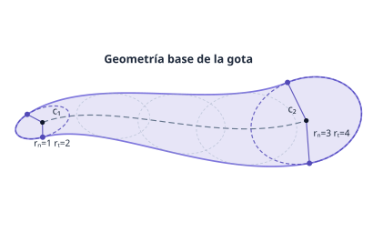
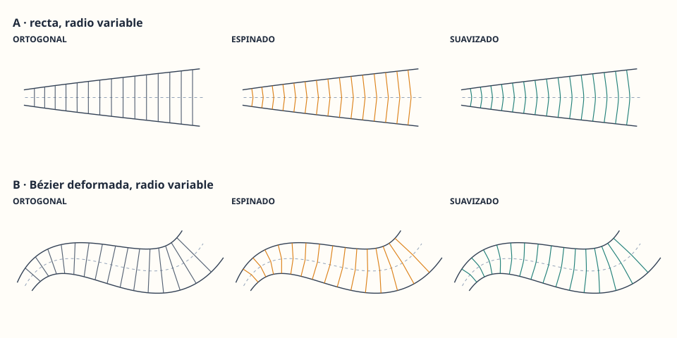

# Primitiva Gota

*Primitiva de dibujo 2D formada por dos elipses unidas por una curva Bézier cúbica.*

## 📌 Descripción General

La **primitiva Gota** es una forma vectorial 2D definida como la envolvente de una familia de elipses (o círculos) cuyo centro recorre una curva Bézier cúbica y cuyo radio varía según una función de perfil. Esta primitiva permite crear formas orgánicas y suaves que combinan las propiedades de las elipses con la flexibilidad de las curvas paramétricas.

**Características principales:**
- Forma definida por 2 puntos extremos (centros de las elipses) y 2 puntos de control (para la Bézier)
- Radio variable a lo largo del camino con control de suavizado
- Soporte para elipses (con relación de aspecto configurable) y círculos
- Sistema de coordenadas intrínsecas para mapeo de texturas y colores
- Composición topológica: cadenas, ciclos, estrellas y figuras complejas
- Antialiasing integrado
- Modelos de color avanzados (RGB, RGB lineal, HSL, Oklch)

---

## 🔷 Especificación Geométrica

### Definición Matemática

Una **gota** se define como el conjunto de puntos `(x, y)` tales que existe `t ∈ [0,1]` donde:

```
|p - c(t)|² - r(t)² ≤ 0
```

Donde:
- **`c(t)`**: Curva Bézier cúbica que define el camino entre los centros
  - `c(t) = (1-t)³·P₀ + 3(1-t)²t·P₁ + 3(1-t)t²·P₂ + t³·P₃`
  - `P₀` y `P₃` son los centros de las elipses extremos
  - `P₁` y `P₂` son los puntos de control

- **`r(t)`**: Función de radio (cuadrática de Bézier o lineal por tramos)
  - Con suavizado = 1: `r(t)` es una única cuadrática por `(0, r₁)`, `(tₘ, rₘ)`, `(1, r₂)`
  - Con suavizado < 1: dos cuadráticas unidas en `tₘ` con pendientes interpoladas

### Parámetros Principales

```java
// Construcción básica
Gota.gotaLineal(centro1, radio1, centro2, radio2, perfil)
Gota.gotaCurva(centro1, radio1, vec1, centro2, radio2, vec2, perfil)

// Perfil del radio
Perfil.radioMedio(rm)              // Radio medio en t=0.5
Perfil.central(central)            // rm = central * (r1 + r2) / 2
Perfil.recto()                     // Tangentes rectas: rm = (r1 + r2) / 2
Perfil.aspecto(lambda1, lambda2)   // Elipses: relación aspecto a/b
```

### Geometría de las Elipses

Para elipses, la condición de pertenencia se generaliza:

```
(d·T)² + λ²(d·T⊥)² - λ²·b²·|T|² ≤ 0
```

Donde:
- `d = p - c(t)`: vector del punto al centro
- `T`: vector tangente unitario al camino
- `T⊥`: vector normal unitario (rotación 90° de T)
- `λ = a/b`: relación de aspecto (radio tangente / radio normal)
- `b`: radio normal (el radio clásico)
- `a = λ·b`: radio tangente

---

## 📐 Sistema de Coordenadas

### Coordenadas Intrínsecas

Cada píxel de la gota tiene coordenadas intrínsecas que permiten un mapeo consistente de colores y texturas:

```
Muestra(t, rho, axial, lateral)
```

- **`t`**: Posición a lo largo del camino `[0,1]`
- **`rho`**: Distancia normalizada al centro `rho = |p - c(t)| / r(t)` donde `0 ≤ rho ≤ 1`
- **`axial`**: Coordenada axial `(p - c)·T / r` (proyección sobre la tangente)
- **`lateral`**: Coordenada lateral `(p - c)·N / r` (proyección sobre la normal)

Se cumple: `rho² = axial² + lateral²`

### Coordenadas de Textura (Tira)

```
Uv(u, v)
```

La **tira** divide la gota en 4 regiones:

```
[0, v₁]    → Tapa trasera (semicírculo del primer círculo)
[v₁, v₂]   → Primera mitad del cuerpo (t ∈ [0, tₘ])
[v₂, v₃]   → Segunda mitad del cuerpo (t ∈ [tₘ, 1])
[v₃, 1]    → Tapa delantera (semicírculo del segundo círculo)
```

- **`u`**: Coordenada horizontal de lado a lado `[0,1]`
  - `u = 0.5` sobre el camino
  - `u = 0` borde izquierdo (respecto al sentido de avance)
  - `u = 1` borde derecho
- **`v`**: Coordenada longitudinal `[0,1]`

## 🎨 Modelos de Color y Textura

### Diagrama de la Primitiva



### Sistema de Coordenadas Intrínsecas



### Modelos de Color

La primitiva soporta múltiples modelos de interpolación de color:

```
┌─────────────────────────────────────────────────────────────┐
│                    MODELOS DE INTERPOLACIÓN                 │
├─────────────────────────────────────────────────────────────┤
│  RGB          │  Interpolación lineal en espacio RGB        │
│  RGB_LINEAL   │  Interpolación lineal gamma-correcta        │
│  HSL          │  Interpolación en espacio HSL               │
│  OKLCH        │  Interpolación en espacio Oklch (perceptual)│
│  Personalizada│  Cualquier función lambda propia            │
└─────────────────────────────────────────────────────────────┘
```

**Configuraciones de color:**

```java
// 1. Dos colores (centro de cada círculo)
Colores.dosColores(colorA, colorB, Mezcla.RGB)

// 2. Dos colores con ajuste de transición
Colores.dosColores(colorA, colorB, ajuste, Mezcla.HSL)

// 3. Cadena axial de 4 colores
Colores.cadena(extremo1, centro1, centro2, extremo2, Mezcla.OKLCH)

// 4. Cadena completa con 3 ajustes
Colores.cadena(e1, c1, c2, e2, ajusteEC1, ajusteCC, ajusteCE2, mezcla)
```

**Parámetros de la cadena axial:**
- `extremo1`: Color en v = 0 (inicio de la tapa trasera)
- `centro1`: Color en v = v₁ (centro del primer círculo)
- `centro2`: Color en v = v₃ (centro del segundo círculo)
- `extremo2`: Color en v = 1 (final de la tapa delantera)
- `ajuste`: Controla cuándo se produce la transición (0 = inicio, 0.5 = centro, 1 = final)

### Modelos de Textura

```
┌─────────────────────────────────────────────────────────────┐
│                     MAPEOS DE TEXTURA                       │
├─────────────────────────────────────────────────────────────┤
│  TIRA         │  Textura a lo largo de la gota              │
│  DISCO        │  Textura en coordenadas polares             │
│  REFERENCIA   │  Textura de referencia 1×2 (cápsula)        │
│  IMAGEN       │  Textura desde archivo de imagen            │
└─────────────────────────────────────────────────────────────┘
```

**Textura de referencia (cápsula 1×2):**


## 🔧 Uso

### Requisitos

- Java 17 o superior
- Maven 3.6+ (opcional)

### Compilación y Ejecución

```bash
# Compilar todo y ejecutar pruebas
mvn test

# Ejecutar un ejemplo específico
echo "Flor" | mvn exec:java -Dexec.mainClass="Flor"

# O usar el script de ejemplos
./ejemplos.sh Flor
```

Las imágenes generadas se guardan en `target/imagenes/`.

### Ejemplos Disponibles

| Ejemplo | Descripción |
|---------|-------------|
| `GotaDemo` | Demostración básica de una gota |
| `Flor` | Composición de gotas formando una flor |
| `Hoja` | Gota configurada como hoja |
| `EstrellaTapas` | Estrella con tapas de semidisco |
| `Figura8` | Dos gotas formando un ocho |
| `GotaTextura` | Gota con textura aplicada |
| `GotaPerfil` | Demostración de diferentes perfiles |
| `GotaColorDemo` | Demostración de modelos de color |
| `GotaSolape` | Pruebas de solapamiento |
| `ArcoDemo` | Arcos formados con gotas |
| `LadosDemo` | Demostración de lados y bordes |


## 🏗️ Arquitectura

### Estructura del Proyecto

```
primitiva-gota/
├── src/
│   ├── main/java/          # Biblioteca principal
│   │   ├── Gota.java           # Primitiva: geometría, SDF y raster
│   │   ├── Coordenadas.java    # Coordenadas intrínsecas
│   │   ├── Colores.java        # Modelos de color
│   │   ├── Texturas.java       # Mapeo de texturas
│   │   ├── Mezcla.java         # Interpolación de colores
│   │   ├── ComposicionColor.java # Composición de rellenos
│   │   └── Composicion.java    # Composición topológica
│   │
│   ├── test/java/          # Pruebas
│   │   ├── Todas.java          # Ejecuta todas las pruebas
│   │   ├── GotaRegresion.java  # Pruebas de regresión
│   │   ├── ComposicionPruebas.java # Pruebas de composición
│   │   └── ...
│   │
│   └── ejemplos/java/      # Ejemplos y demos
│       ├── Flor.java
│       ├── Hoja.java
│       └── ...
│
├── pom.xml                 # Configuración Maven
└── ejemplos.sh             # Script para ejecutar ejemplos
```

### Dependencias entre Clases

```
┌─────────────────────────────────────────────────────────────────┐
│                        FLUJO DE DATOS                           │
├─────────────────────────────────────────────────────────────────┤
│                                                                 │
│   Gota ──[genera]──> Coordenadas ──┬──> Colores ───┐            │
│                                    │               │ (Mezcla)   │
│                                    └──> Texturas ──┘            │
│                                                                 │
│   ComposicionColor (combina 2 rellenos)                         │
│   Composicion (une gotas y las pinta)                           │
│                                                                 │
└─────────────────────────────────────────────────────────────────┘
```

## 📊 Especificación Técnica Detallada

### Algoritmo de Renderizado

1. **División recursiva**: La gota se divide en tramos hasta que el polinomio de grado 6 (para círculos) o 12 (para elipses) puede evaluarse directamente
2. **Evaluación en base de Bernstein**: Los polinomios se evalúan en base de Bernstein para garantizar estabilidad numérica
3. **Antialiasing**: Banda de 0.5 píxeles con evaluación conservadora
4. **Profundidad máxima**: 24 niveles de subdivisión

### Tipos de Solapamiento

| Tipo | Descripción |
|------|-------------|
| `PLANO` | Un único color por píxel (mínimo rho) |
| `TRAZO` | Cada tramo es una capa, con antialiasing propio |

### Perfil del Radio

```
rm = radio en t = tm (por defecto 0.5)
suavizado ∈ [0, 1]:
  - suavizado = 1: una única cuadrática
  - suavizado < 1: dos cuadráticas con pendientes interpoladas
  - suavizado = 0: línea recta con codo en tm
```

### Relación de Aspecto (Elipses)

```
λ = a / b (relación radio tangente / radio normal)
- λ = 1: círculos (algoritmo de grado 6)
- λ ≠ 1: elipses (algoritmo de grado 12)
- Dominio: (0.05, 20)
```

## 🔗 Recursos Adicionales

- [Implementación de referencia en Java](implementacion/java/README.md)
- [Documentación de las clases](implementacion/java/src/main/java/)
- [Pruebas y ejemplos](implementacion/java/src/test/java/)

## 📜 Licencia

Este proyecto se distribuye bajo la [WTFPL](LICENSE) (*Do What The Fuck You Want To Public License*).

> Lo puedes usar, modificar o ignorar. Está aquí por si a alguien le sirve tanto como a mí.

---

*Generado con ❤️ para la comunidad de gráficos 2D*
