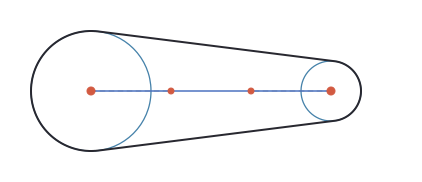
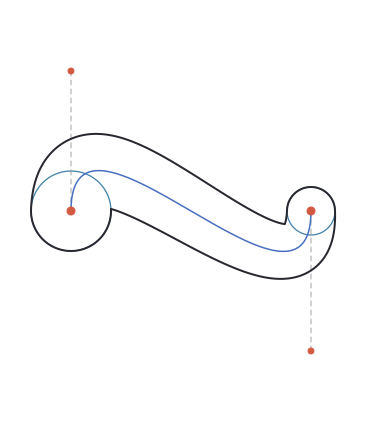
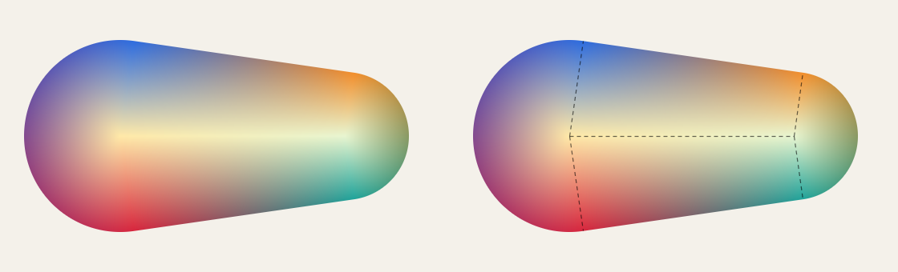
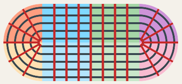

# Primitiva Gota

*Areas de influencia limitadas por el centro dirigido más cercano.*

## 📌 Descripción General

La **primitiva Gota** es una forma vectorial 2D que define las areas de influencia limitadas por el centro más cercano.
Los centros recorre una curva Bézier cúbica y cuyo radio varía según una función de perfil. Esta primitiva permite crear
formas orgánicas y suaves gracias a la flexibilidad de las curvas paramétricas.




**Características principales:**
- Forma definida por 2 puntos extremos (centros de las secciones) y 2 puntos de control (para la Bézier).
- Radio variable a lo largo del camino.
- Sistema de coordenadas intrínsecas para mapeo de texturas y colores.
- Composición topológica: cadenas, ciclos, estrellas y figuras complejas.

## 🔷 Especificación Geométrica

----


## 🎨 Modelos de Color y Textura



### 📐 Sistema de Coordenadas Intrínsecas

Cada píxel de la gota se describe mediante una muestra:

$$
Muestra(t,\rho,axial,lateral)
$$

Las coordenadas se calculan respecto a la sección seleccionada para representar el píxel:

- $t$: posición a lo largo del camino.
- $axial$: proyección normalizada sobre la tangente.
- $lateral$: proyección normalizada sobre la normal.
- $\rho$: distancia radial normalizada respecto a la sección.

Con $d=p-c(t)$, tangente unitaria $T$, normal unitaria $N$, radio tangente $a(t)$ y radio normal $b(t)$:

$$
axial=\frac{d\cdot T}{a(t)}
$$

$$
lateral=\frac{d\cdot N}{b(t)}
$$

$$
\rho=\sqrt{axial^2+lateral^2}
$$

Se cumple:

$$
\rho^2=axial^2+lateral^2
$$

La pertenencia a la sección viene determinada por:

$$
\rho\leq1
$$

En los círculos, donde $a=b=r$, se recupera el sistema de coordenadas circular original. Se utiliza el mismo sistema de coordenadas para ambas geometrías.

### Modos de las Coordenadas



La tira utiliza dos coordenadas normalizadas:

$$
UV=(u,v),\qquad u,v\in[0,1]
$$

- $u$: posición transversal, de un lado al otro de la gota.
- $v$: posición longitudinal, desde la primera tapa hasta la segunda.

En el cuerpo, $u=0.5$ corresponde al camino central. Las coordenadas $u=0$ y $u=1$ representan los lados opuestos. La orientación concreta de esos lados depende del sentido de avance del camino.

La coordenada longitudinal se distribuye en cuatro regiones:

- $[0,v_1]$: tapa inicial.
- $[v_1,v_2]$: primera mitad del cuerpo.
- $[v_2,v_3]$: segunda mitad del cuerpo.
- $[v_3,1]$: tapa final.

El corte central del cuerpo corresponde a $t=t_m$.

Las tapas se representan como semidiscos. Para convertir las coordenadas de la tira en coordenadas del semidisco unidad:

$$
l=2u-1
$$

$$
h=w\sqrt{1-l^2}
$$

Donde $w$ es la profundidad normalizada de la tapa: vale 0 en la costura con el cuerpo y 1 en el arco exterior.

Esta transformación permite utilizar una misma tira de coordenadas para aplicar tanto colores como texturas.

## 🏗️ Arquitectura

### Estructura del Proyecto

```
primitiva_gota/
├── README.md
├── implementacion/
│   └── java/
│       ├── pom.xml
│       ├── src/
│       │   ├── main/java/
│       │   ├── test/java/
│       │   └── ejemplos/java/
│       └── ejemplos.sh
└── ...
```

### Dependencias entre Clases

```
┌─────────────────────────────────────────────────────────────────┐
│                        FLUJO DE DATOS                           │
├─────────────────────────────────────────────────────────────────┤
│                                                                 │
│   Gota ──[genera]──> Coordenadas ──┬──> Colores ───┐            │
│                                    │               │ (Mezcla)   │
│                                    └──> Texturas ──┘            │
│                                                                 │
│   ComposicionColor (combina 2 rellenos)                         │
│   Composicion (une gotas y las pinta)                           │
│                                                                 │
└─────────────────────────────────────────────────────────────────┘
```

## 📊 Especificación Técnica Detallada

### Algoritmo de Renderizado

1. **División recursiva**: la gota se divide en tramos hasta que el polinomio de grado 6 puede evaluarse directamente.
2. **Evaluación en base de Bernstein**: los polinomios se representan y evalúan en esta base, que facilita la subdivisión recursiva y el control de sus valores en cada intervalo.
3. **Antialiasing**: banda de 0.5 píxeles con evaluación conservadora.
4. **Profundidad máxima**: 24 niveles de subdivisión.

### Tipos de Solapamiento

| Tipo | Descripción |
|------|-------------|
| `PLANO` | Un único color por píxel (mínimo $\rho$) |
| `TRAZO` | Cada tramo es una capa, con antialiasing propio |

## 🔧 Uso

### Requisitos

- Java 17 o superior.
- Maven 3.6+ (opcional).

### Compilación y Ejecución

```bash
# Compilar todo y ejecutar pruebas
mvn test

# Ejecutar un ejemplo específico
echo "Flor" | mvn exec:java -Dexec.mainClass="Flor"

# O usar el script de ejemplos
./ejemplos.sh Flor
```

Las imágenes generadas se guardan en `target/imagenes/`.

### Ejemplos Disponibles

| Ejemplo | Descripción |
|---------|-------------|
| `GotaDemo` | Demostración básica de una gota |
| `Flor` | Composición de gotas formando una flor |
| `Hoja` | Gota configurada como hoja |
| `EstrellaTapas` | Estrella con tapas de semidisco |
| `Figura8` | Dos gotas formando un ocho |
| `GotaTextura` | Gota con textura aplicada |
| `GotaPerfil` | Demostración de diferentes perfiles |
| `GotaColorDemo` | Demostración de modelos de color |
| `GotaSolape` | Pruebas de solapamiento |
| `ArcoDemo` | Arcos formados con gotas |
| `LadosDemo` | Demostración de lados y bordes |

## 🔗 Recursos Adicionales

- [Implementación de referencia en Java](implementacion/java/README.md)
- [Pruebas y ejemplos](implementacion/java/src/test/java/)

## 📜 Licencia

Este proyecto se distribuye bajo la [WTFPL](LICENSE) (*Do What The Fuck You Want To Public License*).

> Lo puedes usar, modificar o ignorar. Está aquí por si a alguien le sirve tanto como a mí.

---

*Generado con ❤️ para la comunidad de gráficos 2D*

