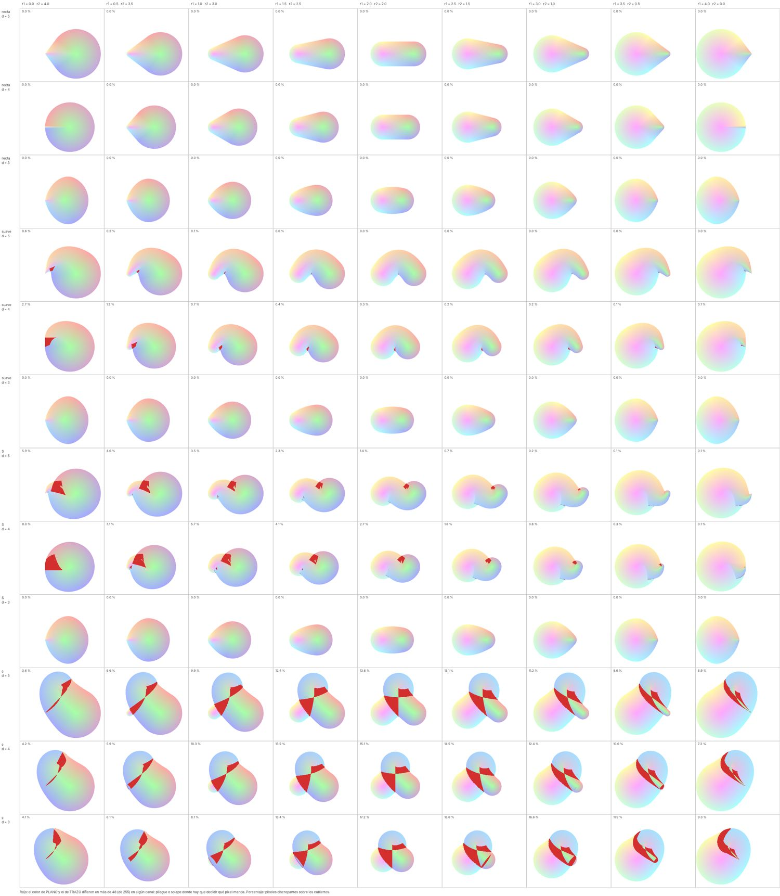
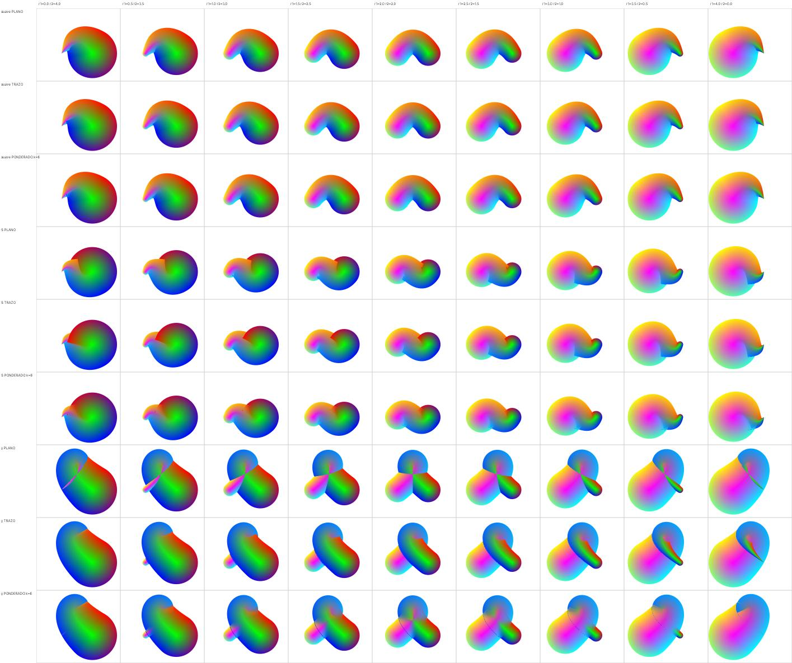
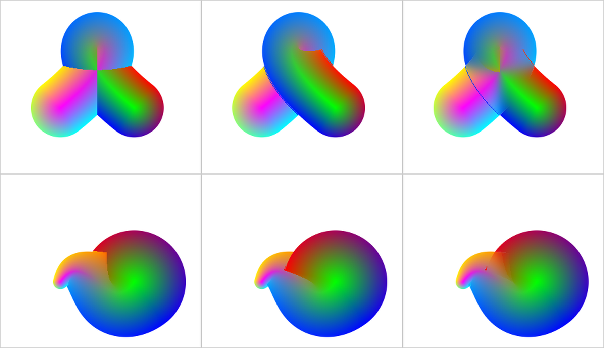
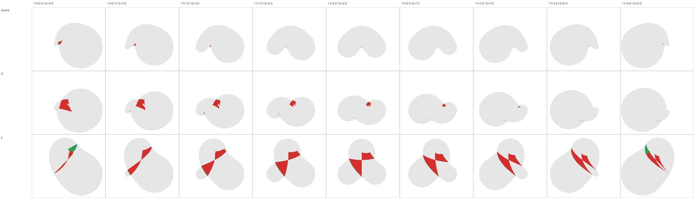
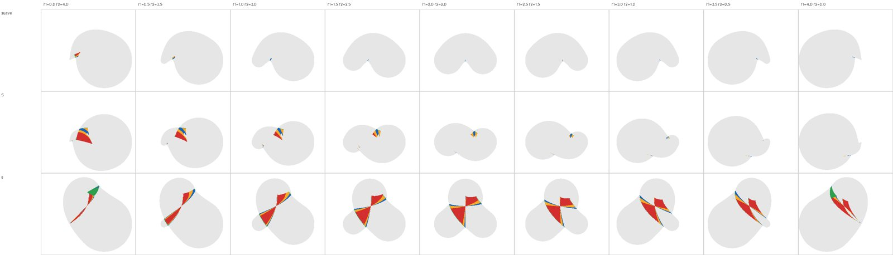
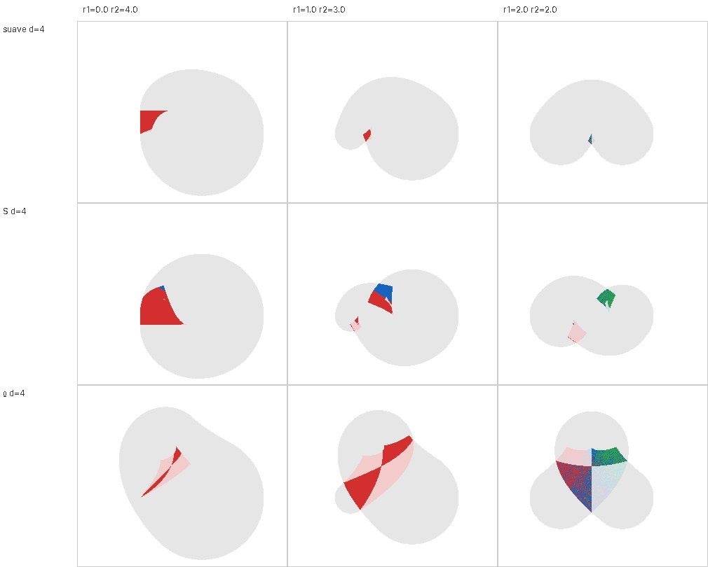

# Estudio del solapamiento: qué píxel manda en los pliegues

Rama de estudio (`estudio_solapes`, sale de `silueta_en_gota`). No hay solución adoptada: este documento reúne el material
medido y lo encontrado fuera, para decidir con datos.

## El problema

Cuando el camino de una gota se pliega o se cruza consigo mismo (filas S y ჲ de las matrices, sobre todo con radio final
grande), varios tramos del camino cubren el mismo píxel y cada uno da coordenadas distintas. La silueta es la misma en
todos los modos; lo que cambia es **qué coordenadas (y por tanto qué color o textura) se le asignan al píxel**:

- `PLANO`: una sola capa por píxel, la solución única de la costura. Deja costuras duras donde dos tramos compiten.
- `TRAZO`: una capa por pasada del camino; la de mayor t tapa a las anteriores. Deja el corte donde termina la pasada superior.

## Cómo medirlo

`SuiteMatriz_03_Colores` genera `suite_matriz_03_colores_discrepancias.png`: en rojo, los píxeles donde el color de PLANO y
el de TRAZO difieren en más de `UMBRAL_DISCREPANCIA` (48 sobre 255, un criterio provisional) en algún canal, y el porcentaje
por celda. Es un detector, no una medida de cuál es correcto. Resultados (d = 3, 4, 5):

- Recta, y suave y S con d = 3: 0 % (formas rígidas, sin solape).
- Suave: hasta 2.7 % (d = 4, r1 = 0). S: hasta 9 % (d = 4, r1 = 0), bajando al crecer r1.
- ჲ: entre el 4 % y el 19 %, con el máximo con radios medios y d = 3.



## Experimento: `Solape.PONDERADO`

Primero, la media 50/50 de los colores de PLANO y TRAZO (fuera de la biblioteca): no resuelve nada (mitad de amplitud en cada
escalón, el doble de escalones, aspecto de doble imagen en ჲ), pero marca bien dónde discrepan.

Después, la mínima suave cuadrática de Quilez entre las dos pasadas: con `a` la distancia con signo de la pasada anterior y
`b` la de la nueva, la opacidad de la nueva es el factor de mezcla (`m = 0.5·h²`, `h = 1 − min(|a−b|/4K, 1)`; peso `m` si
`a < b`, `1 − m` si no). Domina la pasada en la que el píxel está más adentro, y la transición dura 4K píxeles (K = 6 por
defecto, `-Dsolape.k=...`). Ver `Solape.PONDERADO`.

Resultados con `EstudioSolapes 5` (píxeles con salto de color a más de 100 entre vecinos; no distingue los bordes legítimos de
las zonas de color, así que es un indicador grueso):

| forma | solape | (0, 4) | (2, 2) | (4, 0) |
|---|---|---|---|---|
| suave | TRAZO / PONDERADO | 433 / 427 | 411 / 411 | 330 / 322 |
| S | TRAZO / PONDERADO | 517 / 453 | 377 / 371 | 347 / 349 |
| ჲ | TRAZO / PONDERADO | 600 / 599 | 789 / 770 | 757 / 546 |



- Las cuñas de ჲ y el escalón de S pasan a degradados continuos; en (4, 0) el pliegue de ჲ se disuelve.
- El coste: donde los dos campos de color son distintos, el fundido tiene aspecto de semitransparencia.
- La elección de coordenadas dentro de cada pasada sigue siendo la de TRAZO (con su corte duro), y las filas de un píxel sobre
  el borde de la pasada superior, que ya tenía TRAZO, siguen.
- K = 6 no está explorado; `Coordenadas.porRho` trata PONDERADO como PLANO (solo afecta a las composiciones).



## Clasificación de las discrepancias (`ClasificaDiscrepancias`)

Hipótesis inicial: los pliegues locales (cara interior de una curva cerrada) tendrían hebras cercanas en t y los lazos
legítimos hebras lejanas, y cada caso pediría su regla. **No se confirma**: en suave, S y ჲ (d = 5 y 4) casi todos los píxeles
discrepantes tienen dos o más hebras con Δt entre 0.2 y 0.6 o más; con Δt < 0.1 solo hay 75 de 693 píxeles (suave, d = 4,
r1 = 0) y 122 de 2252 (S, d = 4, r1 = 0). Δt no separa los dos fenómenos. En suave y S la discrepancia es el extremo grueso
solapando al brazo, igual que en ჲ pero más pequeña.



Lo que sí separa es el cociente rho_min / rho_max de las hebras del píxel, con rho = |p − c(t)| / r(t) (distancia a la espina
normalizada por el radio de su t; adimensional). Con tres clases provisionales (los cortes 0.9 y 0.7 son un criterio a decidir):
empate (≥ 0.9), medio (0.7 a 0.9) y solape profundo (< 0.7). Con d = 5:

| celda | discrepantes | empate | medio | profundo |
|---|---|---|---|---|
| suave (0, 4) | 164 | 16 | 49 | 81 |
| suave (2, 2) | 6 | 5 | 0 | 0 |
| S (0, 4) | 1561 | 229 | 295 | 1005 |
| S (2, 2) | 248 | 88 | 145 | 3 |
| ჲ (2, 2) | 3318 | 332 | 684 | 2201 |

(en cada fila falta el resto hasta el total: píxeles con una sola hebra.)



- La zona discrepante es una lente: en el interior (rojo) el solape es profundo y la proximidad y el orden de las pasadas se
  contradicen; en el borde (azul y ámbar) las dos pasadas casi empatan.
- En suave la mediana del cociente es ≥ 0.9 con r1 ≥ 1.5 (con r1 de 0 a 1 baja a 0.56–0.88): casi todo es empate y la discrepancia es una banda fina. En ჲ
  la mediana está en torno a 0.5 (0.26 a 0.65).
- Con una sola hebra hay discrepancias, sobre todo en ჲ con (0, 4) y (4, 0) (d = 3: 1050 de 1211 y 2006 de 2733): ahí decide
  la elección de coordenadas dentro de una pasada (las tapas), no la composición entre pasadas.
- Con d = 3 suave y S no discrepan (formas rígidas).

## El producto escalar con la tangente (`EstudioProductoEscalar`, `MapaSigno`)

Idea de Samuel: además de rho, usar la componente de `p − c(t)` a lo largo de la tangente `T(t)` de cada pasada, `u`, y la
orientación relativa entre las tangentes de las dos pasadas. Se midió sobre todos los píxeles con dos o más hebras de las formas
no rígidas (d = 5 y 4), con la fracción de píxeles discrepantes (PLANO frente a TRAZO, > 48 de 255) por clase. En esas zonas la
discrepancia ronda el 49 % de forma general, así que lo que importa es cuánto se aparta cada clase de ese nivel.

- **rho_min/rho_max y cos(T_a, T_b):** no separan (49 % en todas las clases, correlación con la magnitud entre −0.11 y 0.12).
  El cociente de rho clasifica el tipo de solape pero no predice dónde discrepan las dos reglas.
- **Signo de u (en las dos pasadas):**
  - Suave: (+,+) 9 % frente a (−,−) 86.5 %, y se mantiene dentro de cada tramo de t (16 % frente a 86 % con t_a < 0.2; 2.4 %
    frente a 87 % con t_a de 0.2 a 0.5), así que no se explica solo por t.
  - S: (+,+) 12.6 % frente a (−,−) 79.3 % en conjunto, pero dentro de cada tramo de t el efecto casi desaparece (con t_a de 0.2
    a 0.5 todo está entre 90 y 98 %): lo domina t, no el signo.
  - ჲ: 43 % a 56 % en todas las clases; no informa. El mapa muestra ruido de signos en la lente de (2, 2) (empates entre hebras).
- **Mapa:** los signos parten el solape en regiones cuyos bordes son las curvas u = 0 de cada pasada, es decir, la frontera
  banda/tapa de las coordenadas. Parece que el borde de discrepancia se parece más a las fronteras de zona de las coordenadas
  que a la de empate de rho (sin comprobar).
- **Lo que no sé:** si el signo predice o solo coincide con la zona; con (2, 2) en S el mapa invierte el patrón de la tabla
  (verde discrepante, rojo no); los cortes 0.5 de banda/tapa y 0 del signo son arbitrarios; solo se midió dónde discrepan las
  dos reglas, no cuál tiene razón.



## Lo encontrado fuera

Búsqueda corta (no cubre pintura vectorial de difusión, pintura digital ni editores comerciales). No apareció una regla
ampliamente adoptada para elegir qué píxel manda en el solape de un trazo de anchura variable con color.

- Hsu y Lee, [Skeletal Strokes](https://dl.acm.org/doi/pdf/10.1145/192161.192186) (SIGGRAPH 1994), y
  [Folding Avoidance in Skeletal Strokes](https://diglib.eg.org/handle/10.2312/SBM.SBM10.033-040) (2010): el pliegue de las
  costillas en el interior de una curva cerrada. La solución de Adobe, según su [patente US8674995](https://patents.google.com/patent/US8674995)
  (no pude abrir el paper), es geométrica: detecta el tramo retrógrado del borde interior y mueve el extremo interior de
  cada costilla afectada al punto de autointersección. Cambia las proporciones en la zona y se describe para una sola región.
- [Stroke Parameterization](https://www.dgp.toronto.edu/~rms/pubs/StrokeParamEG13.html) (Eurographics 2013, con el
  [PDF de Autodesk](https://research.autodesk.com/app/uploads/2023/03/stroke-parameterization.pdf_recL8bfg0ZmZMXDgo.pdf)):
  en las autointersecciones duplica la geometría y conserva todos los valores de parámetro, uno por pasada, dejando la
  elección a la aplicación (por ejemplo, mezclando al pintar). Anchura constante; sus autores dicen que sería mejor crear
  regiones de solape en los giros agudos y que su técnica no lo hace aún.
- Quilez, [smooth minimum](https://iquilezles.org/articles/smin): el factor de mezcla de la mínima suave sirve para
  mezclar materiales en la transición; el artículo no da receta para el color.

Tres familias, y dónde cae cada una aquí: evitar el pliegue (como la forma rígida de d ≤ r1+r2, o Adobe), conservar todos los
candidatos y decidir al pintar (TRAZO, Schmidt) y mezclar con peso suave cerca del cruce (PONDERADO, Quilez).

## Preguntas abiertas

- Qué clase de solape es cada píxel (cortes 0.9 y 0.7 del cociente de rho, provisionales) y qué regla corresponde a cada una.
- Qué pasada debe mandar: la última (TRAZO), la más adentro (la profundidad que usa PONDERADO), la de menor distancia a su
  centro (PLANO)...
- Si basta suavizar la composición entre pasadas o hay que mezclar también las coordenadas dentro de cada pasada.
- Criterios y umbrales de las suites (48 de 255 en el detector, 100 en `EstudioSolapes`), para configurarlos y documentarlos.
- Probar otros K y el resto de variantes de la mínima suave (cúbica, exponencial).

## Reproducir

```
java -cp ... EstudioSolapes 5          # imagen estudio_solapes_d5.png y la tabla de saltos
java -Dsolape.k=2 -cp ... EstudioSolapes 5
```
