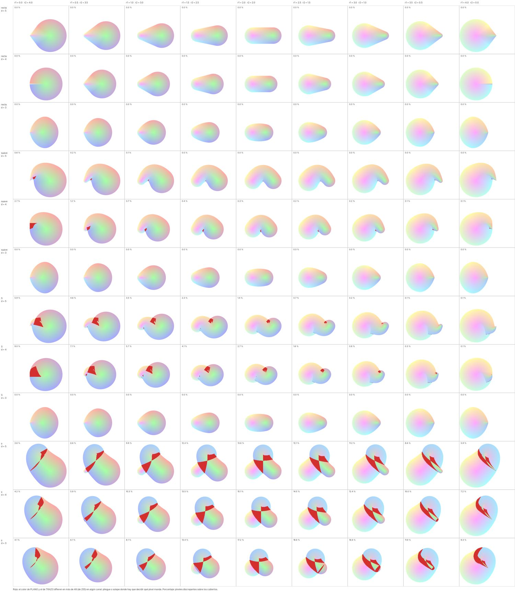
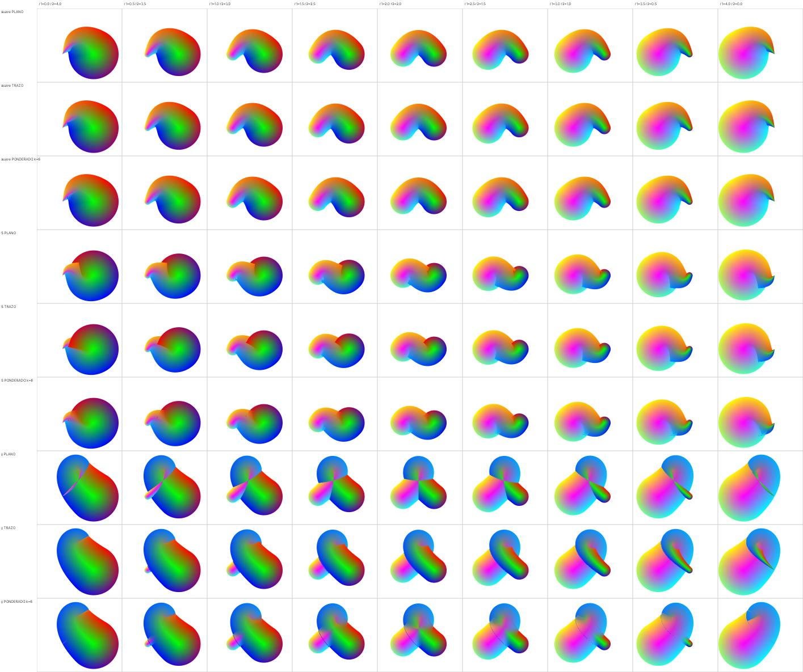
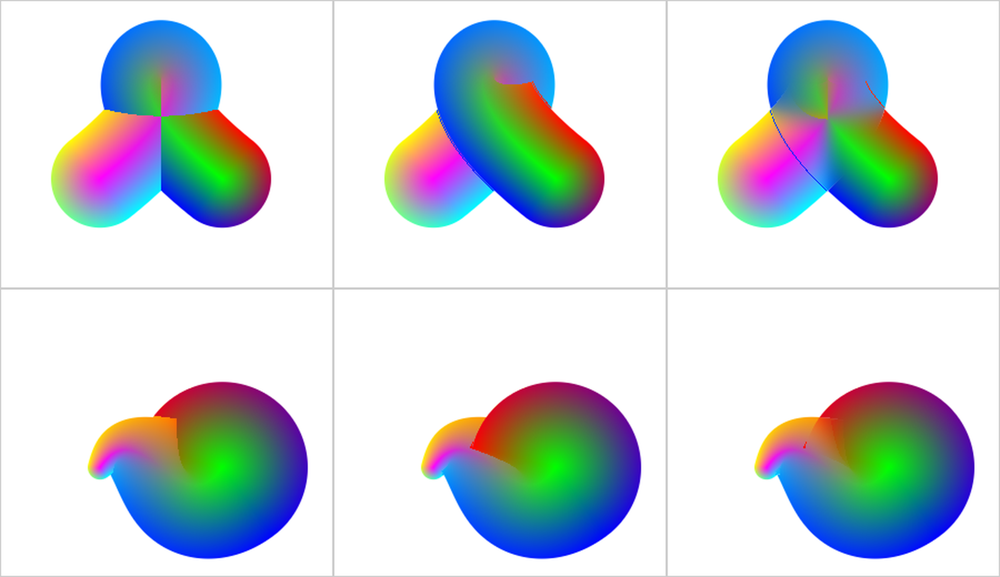
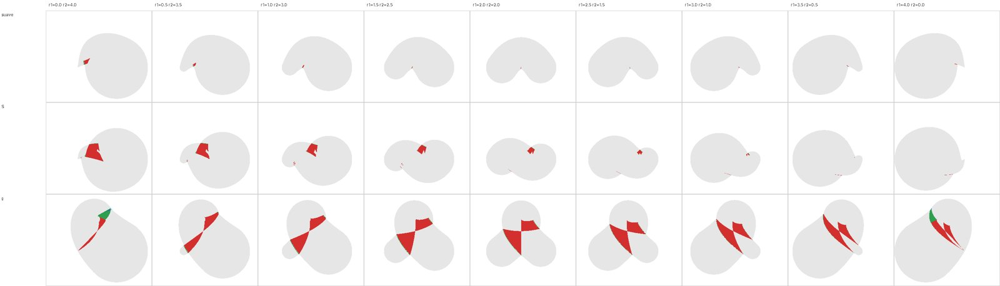
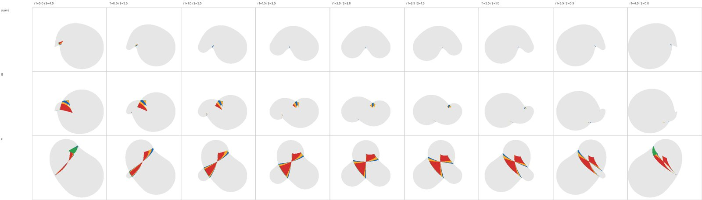
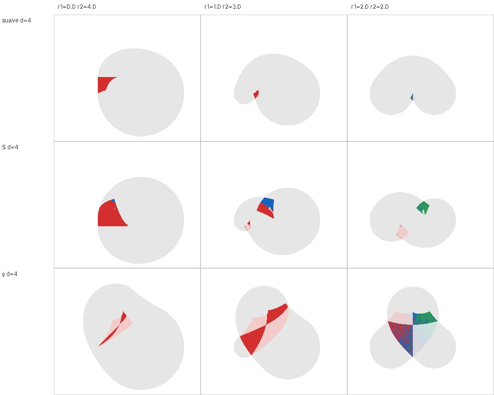
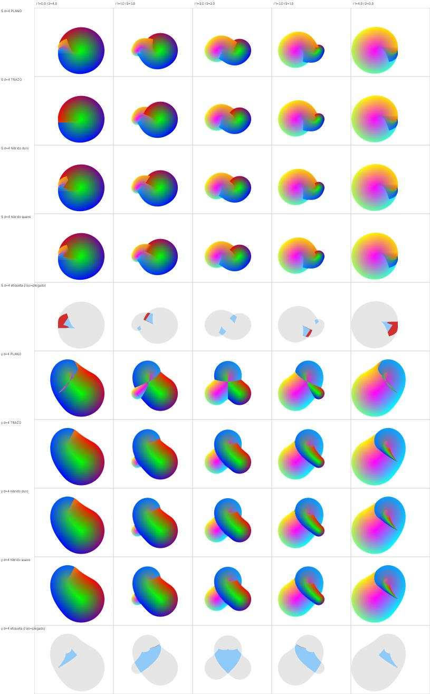
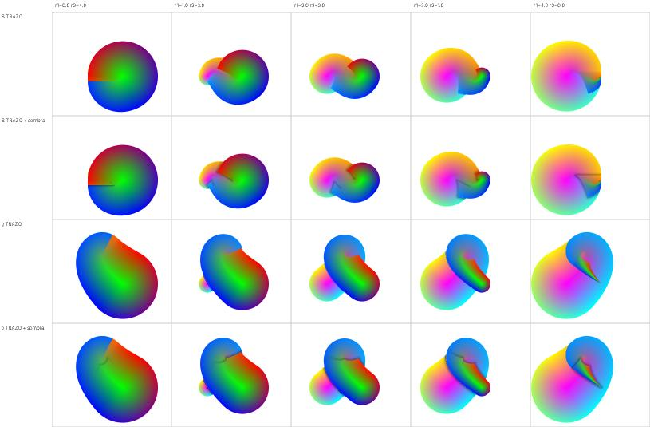
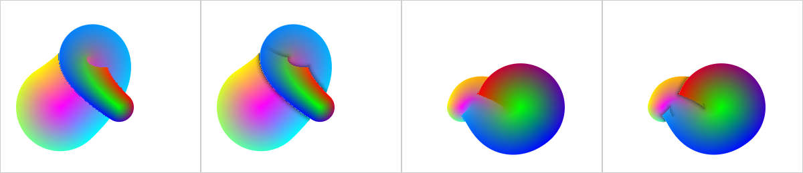

# Estudio del solapamiento: qué píxel manda en los pliegues

Rama de estudio (`estudio_solapes`, sale de `silueta_en_gota`). No hay solución adoptada: este documento reúne el material
medido y lo encontrado fuera, para decidir con datos.

## El problema

Cuando el camino de una gota se pliega o se cruza consigo mismo (filas S y ჲ de las matrices, sobre todo con radio final
grande), varios tramos del camino cubren el mismo píxel y cada uno da coordenadas distintas. La silueta es la misma en
todos los modos; lo que cambia es **qué coordenadas (y por tanto qué color o textura) se le asignan al píxel**:

- `PLANO`: una sola capa por píxel, la solución única de la costura. Deja costuras duras donde dos tramos compiten.
- `TRAZO`: una capa por pasada del camino; la de mayor t tapa a las anteriores. Deja el corte donde termina la pasada superior.

## Cómo medirlo

`SuiteMatriz_03_Colores` genera `suite_matriz_03_colores_discrepancias.png`: en rojo, los píxeles donde el color de PLANO y
el de TRAZO difieren en más de `UMBRAL_DISCREPANCIA` (48 sobre 255, un criterio provisional) en algún canal, y el porcentaje
por celda. Es un detector, no una medida de cuál es correcto. Resultados (d = 3, 4, 5):

- Recta, y suave y S con d = 3: 0 % (formas rígidas, sin solape).
- Suave: hasta 2.7 % (d = 4, r1 = 0). S: hasta 9 % (d = 4, r1 = 0), bajando al crecer r1.
- ჲ: entre el 4 % y el 19 %, con el máximo con radios medios y d = 3.



## Experimento: `Solape.PONDERADO`

Primero, la media 50/50 de los colores de PLANO y TRAZO (fuera de la biblioteca): no resuelve nada (mitad de amplitud en cada
escalón, el doble de escalones, aspecto de doble imagen en ჲ), pero marca bien dónde discrepan.

Después, la mínima suave cuadrática de Quilez entre las dos pasadas: con `a` la distancia con signo de la pasada anterior y
`b` la de la nueva, la opacidad de la nueva es el factor de mezcla (`m = 0.5·h²`, `h = 1 − min(|a−b|/4K, 1)`; peso `m` si
`a < b`, `1 − m` si no). Domina la pasada en la que el píxel está más adentro, y la transición dura 4K píxeles (K = 6 por
defecto, `-Dsolape.k=...`). Ver `Solape.PONDERADO`.

Resultados con `EstudioSolapes 5` (píxeles con salto de color a más de 100 entre vecinos; no distingue los bordes legítimos de
las zonas de color, así que es un indicador grueso):

| forma | solape | (0, 4) | (2, 2) | (4, 0) |
|---|---|---|---|---|
| suave | TRAZO / PONDERADO | 433 / 427 | 411 / 411 | 330 / 322 |
| S | TRAZO / PONDERADO | 517 / 453 | 377 / 371 | 347 / 349 |
| ჲ | TRAZO / PONDERADO | 600 / 599 | 789 / 770 | 757 / 546 |



- Las cuñas de ჲ y el escalón de S pasan a degradados continuos; en (4, 0) el pliegue de ჲ se disuelve.
- El coste: donde los dos campos de color son distintos, el fundido tiene aspecto de semitransparencia.
- La elección de coordenadas dentro de cada pasada sigue siendo la de TRAZO (con su corte duro), y las filas de un píxel sobre
  el borde de la pasada superior, que ya tenía TRAZO, siguen.
- K = 6 no está explorado; `Coordenadas.porRho` trata PONDERADO como PLANO (solo afecta a las composiciones).



## Clasificación de las discrepancias (`ClasificaDiscrepancias`)

Hipótesis inicial: los pliegues locales (cara interior de una curva cerrada) tendrían hebras cercanas en t y los lazos
legítimos hebras lejanas, y cada caso pediría su regla. **No se confirma**: en suave, S y ჲ (d = 5 y 4) casi todos los píxeles
discrepantes tienen dos o más hebras con Δt entre 0.2 y 0.6 o más; con Δt < 0.1 solo hay 75 de 693 píxeles (suave, d = 4,
r1 = 0) y 122 de 2252 (S, d = 4, r1 = 0). Δt no separa los dos fenómenos. En suave y S la discrepancia es el extremo grueso
solapando al brazo, igual que en ჲ pero más pequeña.



Lo que sí separa es el cociente rho_min / rho_max de las hebras del píxel, con rho = |p − c(t)| / r(t) (distancia a la espina
normalizada por el radio de su t; adimensional). Con tres clases provisionales (los cortes 0.9 y 0.7 son un criterio a decidir):
empate (≥ 0.9), medio (0.7 a 0.9) y solape profundo (< 0.7). Con d = 5:

| celda | discrepantes | empate | medio | profundo |
|---|---|---|---|---|
| suave (0, 4) | 164 | 16 | 49 | 81 |
| suave (2, 2) | 6 | 5 | 0 | 0 |
| S (0, 4) | 1561 | 229 | 295 | 1005 |
| S (2, 2) | 248 | 88 | 145 | 3 |
| ჲ (2, 2) | 3318 | 332 | 684 | 2201 |

(en cada fila falta el resto hasta el total: píxeles con una sola hebra.)



- La zona discrepante es una lente: en el interior (rojo) el solape es profundo y la proximidad y el orden de las pasadas se
  contradicen; en el borde (azul y ámbar) las dos pasadas casi empatan.
- En suave la mediana del cociente es ≥ 0.9 con r1 ≥ 1.5 (con r1 de 0 a 1 baja a 0.56–0.88): casi todo es empate y la discrepancia es una banda fina. En ჲ
  la mediana está en torno a 0.5 (0.26 a 0.65).
- Con una sola hebra hay discrepancias, sobre todo en ჲ con (0, 4) y (4, 0) (d = 3: 1050 de 1211 y 2006 de 2733): ahí decide
  la elección de coordenadas dentro de una pasada (las tapas), no la composición entre pasadas.
- Con d = 3 suave y S no discrepan (formas rígidas).

## El producto escalar con la tangente (`EstudioProductoEscalar`, `MapaSigno`)

Idea de Samuel: además de rho, usar la componente de `p − c(t)` a lo largo de la tangente `T(t)` de cada pasada, `u`, y la
orientación relativa entre las tangentes de las dos pasadas. Se midió sobre todos los píxeles con dos o más hebras de las formas
no rígidas (d = 5 y 4), con la fracción de píxeles discrepantes (PLANO frente a TRAZO, > 48 de 255) por clase. En esas zonas la
discrepancia ronda el 49 % de forma general, así que lo que importa es cuánto se aparta cada clase de ese nivel.

- **rho_min/rho_max y cos(T_a, T_b):** no separan (49 % en todas las clases, correlación con la magnitud entre −0.11 y 0.12).
  El cociente de rho clasifica el tipo de solape pero no predice dónde discrepan las dos reglas.
- **Signo de u (en las dos pasadas):**
  - Suave: (+,+) 9 % frente a (−,−) 86.5 %, y se mantiene dentro de cada tramo de t (16 % frente a 86 % con t_a < 0.2; 2.4 %
    frente a 87 % con t_a de 0.2 a 0.5), así que no se explica solo por t.
  - S: (+,+) 12.6 % frente a (−,−) 79.3 % en conjunto, pero dentro de cada tramo de t el efecto casi desaparece (con t_a de 0.2
    a 0.5 todo está entre 90 y 98 %): lo domina t, no el signo.
  - ჲ: 43 % a 56 % en todas las clases; no informa. El mapa muestra ruido de signos en la lente de (2, 2) (empates entre hebras).
- **Mapa:** los signos parten el solape en regiones cuyos bordes son las curvas u = 0 de cada pasada, es decir, la frontera
  banda/tapa de las coordenadas. Parece que el borde de discrepancia se parece más a las fronteras de zona de las coordenadas
  que a la de empate de rho (sin comprobar).
- **Lo que no sé:** si el signo predice o solo coincide con la zona; con (2, 2) en S el mapa invierte el patrón de la tabla
  (verde discrepante, rojo no); los cortes 0.5 de banda/tapa y 0 del signo son arbitrarios; solo se midió dónde discrepan las
  dos reglas, no cuál tiene razón.



## Separar solape legítimo de pliegue de codo cerrado (`EstudioEtiquetaCurvatura`)

Para saber si alguna variable separa los dos fenómenos hace falta una etiqueta independiente. Criterio geométrico (el de
los pliegues de Skeletal Strokes): un píxel es **plegado** si en alguna de sus pasadas está en el lado cóncavo de la espina más
allá del centro de curvatura (distancia normal > 1/|κ|); si no, **legítimo**. Es aproximado (κ por diferencias finitas, sin r'(t)).
Con d = 5 y 4, píxeles con dos o más hebras de las formas no rígidas:

| forma | plegado | legítimo | discrepa PLANO≠TRAZO (plegado / legítimo) |
|---|---|---|---|
| suave | 8 | 3092 | 37.5 % / 47.8 % |
| S | 7161 | 14644 | 50.1 % / 45.4 % |
| ჲ | 414 | 84422 | 50.0 % / 49.5 % |

- **Qué casos son pliegues:** por este criterio, casi todo el solape de suave y de ჲ es legítimo (cruce de partes del
  camino); un tercio del de S es plegado.
- **La etiqueta no predice la discrepancia** PLANO/TRAZO (≈ 50 % en las dos clases).

AUC de cada variable para separar plegado de legítimo (0.5 = no separa; 1 = el plegado tiene siempre valores mayores):

| variable | suave (8 px) | S | ჲ (414 px) |
|---|---|---|---|
| cos(T_a, T_b) con signo | 0.73 | 0.78 | 0.57 |
| \|cos(T_a, T_b)\| | 0.70 | 0.67 | 0.56 |
| rho_min/rho_max | 0.58 | 0.46 | 0.78 |
| Δt | 0.30 | 0.83 | 0.00 |
| u/r (pasada baja, alta) | 0.49, 0.51 | 0.49, 0.52 | 0.52, 0.48 |
| signo (−,−) de u | 0.50 | 0.53 | 0.51 |

- El **signo de u** y u/r no separan (≈ 0.5).
- El **coseno con signo entre las tangentes de las dos pasadas** es el único que apunta en el mismo sentido en las tres formas
  (los píxeles plegados tienen tangentes más paralelas), con 0.78 en S y 0.57 en ჲ; en suave solo hay 8 píxeles plegados.
- **Δt** separa, pero en sentido contrario en S (0.83) y en ჲ (0.00): no sirve como regla única.
- **rho_min/rho_max** también cambia de signo entre formas (0.46 en S, 0.78 en ჲ).
- Límites: etiqueta aproximada, clases muy desiguales (suave 8, ჲ 414 píxeles plegados), píxeles vecinos correlacionados (el AUC
  cuenta píxeles, no casos independientes), d = 5 y 4 agrupadas y solo color.

## Prueba híbrida: PLANO donde hay pliegue, TRAZO donde es legítimo (`EstudioHibrido`)

A nivel de imagen: con la etiqueta de curvatura, el color de PLANO en los píxeles plegados y el de TRAZO en el resto, con corte
duro o con una transición suave (smoothstep de 0.15 sobre `|κ|·v − 1`). Píxeles con salto de color > 100 entre vecinos (mismo
indicador grueso de antes, que cuenta también los bordes legítimos de color), columnas (0, 4) y (0.5, 3.5):

| forma, d | PLANO | TRAZO | híbrido duro | híbrido suave |
|---|---|---|---|---|
| S, 5 | 446 / 442 | 516 / 481 | 515 / 503 | 463 / 444 |
| S, 4 | 416 / 404 | 440 / 469 | 546 / 462 | 491 / 423 |

- En suave y ჲ el híbrido es prácticamente TRAZO (casi no hay píxeles plegados por este criterio): ჲ queda entre 548 y 789 igual
  que TRAZO, con las cuñas de PLANO fuera.
- En S los píxeles plegados son franjas finas junto al borde de la lente; el híbrido suave baja los saltos hacia el nivel de
  PLANO, pero el corte duro puede empeorarlos (S, d = 4, (0, 4): 546 frente a 440 de TRAZO).
- Las costuras grandes que se ven en TRAZO (el corte diagonal de ჲ, el escalón de S) son bordes de la capa superior en solape
  legítimo: el híbrido no las toca, que es coherente con la idea de resolverlas con pistas de oclusión y no con otra regla.
- Es una decisión píxel a píxel sobre imágenes ya compuestas: no sustituye a una regla dentro de `Solape`, solo mide si la etiqueta
  hace algo útil. Límites: indicador grueso, solo color, sin juicio estético fuera de mi lectura de las imágenes.



## Pistas de oclusión (`EstudioOclusion`)

Donde el solape es legítimo el borde de la capa superior es una oclusión real: se probó leerlo como pliegue en vez de como corte.
Sobre la imagen de TRAZO se oscurece suavemente (intensidad 0.45, 9 px) la pasada inferior junto al borde de la superior (píxeles
con una sola hebra cuyo vecino solapado tiene una t mayor).




- En ჲ la sombra hace que el trozo superior se lea como cinta que pasa por encima; en S marca el borde de la tapa sobre el brazo.
- Se ven también los defectos que ya había: filas de píxeles sueltos de otro color a lo largo de algunos bordes de la capa superior
  (en TRAZO, sin sombra); la sombra los acompaña.
- Intensidad y ancho son valores míos sin explorar; solo color; la valoración estética es mía y es lo que más falta por decidir.
- Es un efecto de imagen sobre el orden de pasadas de TRAZO: no es una regla de `Solape` y en una implementación real pediría una
  pasada posterior sobre las capas ya compuestas (su coste no está medido).

## Lo encontrado fuera

Búsqueda corta (no cubre pintura vectorial de difusión, pintura digital ni editores comerciales). No apareció una regla
ampliamente adoptada para elegir qué píxel manda en el solape de un trazo de anchura variable con color.

- Hsu y Lee, [Skeletal Strokes](https://dl.acm.org/doi/pdf/10.1145/192161.192186) (SIGGRAPH 1994), y
  [Folding Avoidance in Skeletal Strokes](https://diglib.eg.org/handle/10.2312/SBM.SBM10.033-040) (2010): el pliegue de las
  costillas en el interior de una curva cerrada. La solución de Adobe, según su [patente US8674995](https://patents.google.com/patent/US8674995)
  (no pude abrir el paper), es geométrica: detecta el tramo retrógrado del borde interior y mueve el extremo interior de
  cada costilla afectada al punto de autointersección. Cambia las proporciones en la zona y se describe para una sola región.
- [Stroke Parameterization](https://www.dgp.toronto.edu/~rms/pubs/StrokeParamEG13.html) (Eurographics 2013, con el
  [PDF de Autodesk](https://research.autodesk.com/app/uploads/2023/03/stroke-parameterization.pdf_recL8bfg0ZmZMXDgo.pdf)):
  en las autointersecciones duplica la geometría y conserva todos los valores de parámetro, uno por pasada, dejando la
  elección a la aplicación (por ejemplo, mezclando al pintar). Anchura constante; sus autores dicen que sería mejor crear
  regiones de solape en los giros agudos y que su técnica no lo hace aún.
- Quilez, [smooth minimum](https://iquilezles.org/articles/smin): el factor de mezcla de la mínima suave sirve para
  mezclar materiales en la transición; el artículo no da receta para el color.

Tres familias, y dónde cae cada una aquí: evitar el pliegue (como la forma rígida de d ≤ r1+r2, o Adobe), conservar todos los
candidatos y decidir al pintar (TRAZO, Schmidt) y mezclar con peso suave cerca del cruce (PONDERADO, Quilez).

## Preguntas abiertas

- Qué clase de solape es cada píxel (cortes 0.9 y 0.7 del cociente de rho, provisionales) y qué regla corresponde a cada una.
- Qué pasada debe mandar: la última (TRAZO), la más adentro (la profundidad que usa PONDERADO), la de menor distancia a su
  centro (PLANO)...
- Si basta suavizar la composición entre pasadas o hay que mezclar también las coordenadas dentro de cada pasada.
- Criterios y umbrales de las suites (48 de 255 en el detector, 100 en `EstudioSolapes`), para configurarlos y documentarlos.
- Probar otros K y el resto de variantes de la mínima suave (cúbica, exponencial).

## Reproducir

```
java -cp ... EstudioSolapes 5          # imagen estudio_solapes_d5.png y la tabla de saltos
java -Dsolape.k=2 -cp ... EstudioSolapes 5
```

## Barniz: promediar en uv (`Solape.PONDERADO_UV`)

Experimento: en vez de mezclar colores, se promedian (t, u, v) de las pasadas con el peso de Quilez y se muestrea una sola vez con la uv media.

- Con degradado el resultado es continuo: el color oculta los pliegues.
- Con la textura guía los pliegues siguen ahí como banda de líneas comprimidas y onduladas (la media de dos uv no paralelas no es un punto real de la espina).
- El corte recto de la costura no cambia: no viene del solape.

Conclusión: es un barniz (como el antialiasing), no una solución. Se aplica al final, cuando ya esté decidido qué píxel manda; mientras se estudian los pliegues se mira sin barniz.

Imágenes: `estudio/uv_textura_d4.jpg`, `estudio/uv_degradado_d4.jpg`. Reproducir: `EstudioUV` (d=4).

## Delimitar: legítimo / compresión / pliegue (J = 1 + κ·y)

Antes de decidir qué píxel manda, se delimitan las zonas de solape (píxeles con 2+ hebras, d = 5 y 4) con el factor de escala lateral de la malla uv, J = 1 − |κ|·y en el lado cóncavo (mínimo entre las pasadas):

- **pliegue:** J ≤ 0 (inversión); **compresión:** 0 < J < 0,3 (umbral provisional); **legítimo:** el resto.

| forma | legítimo | compresión | pliegue |
|---|---|---|---|
| ჲ (d=5, 4) | >98 % | <2 % | <1 % |
| S d=4 | 3033 px | 4419 px | 5281 px |
| S d=5 | 2670 px | 4527 px | 1883 px |
| suave | casi todo | unos px | 0–8 px |

- ჲ: el solape es la lente del lazo, legítimo; solo una franja de compresión en el borde del cierre.
- S: pliegue y compresión en la cara interior del codo, sobre todo con r1=0 o r2=0.
- El detector PLANO≠TRAZO discrepa ~50 % en las tres clases: mide que hay solape, no que haya pliegue, así que no valida la clasificación.
- Sin validar: las clases son geométricas (sin referencia independiente); κ por diferencias finitas, r′(t) ignorada. Siguiente paso: contrastar la compresión con la distorsión real de la textura guía.

Imagen: `estudio/tres_clases_d5_d4.jpg` (verde legítimo, naranja compresión, rojo pliegue; oscuro = PLANO≠TRAZO). Reproducir: `EstudioTresClases`.

## Comprobar las clases con la textura (J frente a la distorsión real)

Imagen: `estudio/tres_clases_textura.jpg` (textura guía con TRAZO; segunda fila de cada caso con compresión en naranja y pliegue en rojo). Código: `EstudioTexturaClases`, `EstudioDensidadTexels`, `EstudioSaltosUv`.

- **Densidad de texels** |det ∂(u,v)/∂(x,y)| respecto a la mediana de los píxeles de una hebra con el mismo t y rho (sin píxeles con salto): no separa las clases (legítimo Q≈2 en las tres formas; en S compresión 1,19 y pliegue 1,37 frente a 1,84 del legítimo). Con signo, ningún píxel sale invertido: la biblioteca no produce uv invertida, el pliegue se manifiesta como salto de uv. Al excluir los saltos del cálculo se deja fuera justo ese caso.
- **Saltos de uv** (|Δt|>0,03 o |Δu|,|Δv|>0,2 a ±1–2 px), % de píxeles con 2+ hebras:

| forma | legítimo | compresión | pliegue |
|---|---|---|---|
| ჲ | 4,1 | 34,1 | 47,6 |
| suave | 53,4 | 75,1 | 75,0 (solo 8 px) |
| S | 27,4 | 19,1 | 25,5 |

- ჲ: J separa bien (el pliegue tiene ~12 veces más saltos que el legítimo). El tubo que se estrecha se explica por saltos de uv, no por compresión; la hipótesis de r′(t) no se sostiene (r′ solo añade cizalla, el determinante es |c′|(1−κy)·r); queda por comprobar la velocidad |c′(t)|.
- suave: separa, pero el legítimo ya tiene >50 % de saltos y la muestra de pliegue es mínima.
- S: no separa; legítimo y pliegue se mezclan, y puede haber corte de costura (no del solape) en la cuenta.

Cautelas: las clases siguen siendo geométricas; el umbral 0,3 y el de salto son provisionales; la referencia de Q sigue sesgada. Siguiente paso posible: excluir el corte de costura en S y repetir el recuento de saltos.

## Clasificar por conexión en t y corte por f

Idea (Samuel): un píxel con 2+ hebras es solape legítimo si las zonas de t que dan sus hebras no conectan entre sí, y pliegue si son una única zona continua en t.

- Implementación (`EstudioConexion`): nodos (píxel, hebra); dos nodos vecinos se unen si |Δt| < 0,03 (p99 del paso entre píxeles vecinos de una hebra: 0,008–0,02). Para que sea local se busca el camino solo dentro de una ventana de ±f·r(t) alrededor del píxel. Un anillo común a todo el solape no sirve: la búsqueda recorre el cuerpo del trazo y conecta hojas lejanas.
- Con ventana pequeña (f ≤ 0,12) casi todo sale legítimo; entre f=0,25 y 1 el porcentaje de pliegue crece de forma continua (S d=4: 3 % → 22 % → 57 %; ჲ d=4: 1,6 % → 13 % → 50 %). No hay meseta, y no coincide con J (en ჲ las clases de J y las de conexión no se corresponden; en S señalan la misma cuña pero dan signos distintos).
- Mapa de calor (`EstudioMapaCorte`, `estudio/mapa_f_d4.jpg`): la f mínima a la que las hojas conectan es una distancia radial a un punto de unión de las hojas (con distancia euclídea los contornos son arcos concéntricos; con Chebyshev salían ángulos rectos, artefacto de la métrica). El corte f ≈ 0,5 equivale a un disco de radio 0,5·r alrededor del punto de unión.
- Corte duro configurable (`-Destudio.fcorte`, por defecto 0,6; Samuel propone ≈ 0,6): lo que supera el corte o no conecta es solape legítimo (verde oscuro); la zona por debajo mantiene el valor de f, que puede servir para distinguir compresión de pliegue. Imágenes: `estudio/mapa_corte_d4.jpg`, `estudio/mapa_corte_d5.jpg`.
- `EstudioComparaConexion` / `estudio/conexion_frente_a_J_d4.jpg`: textura TRAZO con las clases de J y las de conexión superpuestas.

Abierto: ver si en una silueta tipo caracol conviven solape legítimo y pliegue en la misma zona (hipótesis); habría que clasificar por pares de hebras adyacentes, no solo baja/alta; la elección de los cortes (0,6; y uno posible entre compresión y pliegue) es una decisión de diseño, no de los datos.

## ¿Qué indica f? (contraste con la textura)

Hipótesis: f (fracción de r a la que las hojas conectan) representa la compresión del pliegue. Contraste (`EstudioIndicadorF`, píxeles solapados de suave, S y ჲ con d = 5 y 4), por tramos de f y con Spearman en f ≤ 0,6:

| tramo de f | S: salto de pasada | ჲ: salto de pasada |
|---|---|---|
| 0,1–0,2 | 96 % | 78 % |
| 0,2–0,3 | 62 % | 29 % |
| 0,3–0,4 | 32 % | 8 % |
| 0,4–0,5 | 19 % | 5 % |
| 0,5–0,6 | 12,5 % | 3 % |
| > 0,6 | 11 % | 4 % |

- **Correlación con la discontinuidad de pasada:** Spearman f–salto −0,39 (suave), −0,27 (S), −0,20 (ჲ). Cuanto menor es f, más a menudo cambia la pasada ganadora.
- **Sin correlación con la densidad de texels:** f–Q −0,03 (suave), −0,07 (S), +0,19 (ჲ, signo contrario). Cautela: Q solo se calcula en píxeles sin saltos, y los de f < 0,3 tienen entre 60 y 100 % de saltos, así que quedan casi fuera (sesgo de supervivencia); la referencia de Q sigue sesgada.
- **Confusión con la forma:** cerca de la punta del abanico la zona es más estrecha, y eso también eleva el salto; no se ha separado.

Lectura: f es un indicador de proximidad al pliegue y de discontinuidad de pasada. No hace falta que sea causal para servir de indicador. «Indicador de compresión de la textura» queda pendiente de comprobar con una medida por pasada (la biblioteca no expone hoy la uv de una pasada concreta).

## Signo de J por hebra y esquema superpuesto

Con la superficie S(t, u) = (x(t, u), y(t, u), t): cada hebra de un píxel es un punto de su preimagen. El signo de J = 1 − κ·y por hebra distingue las preimágenes de la misma orientación (J > 0 en todas: solape legítimo) de las de orientación opuesta (alguna con J ≤ 0: pliegue de la proyección). Medido en `EstudioSignoJ`:

- ჲ y suave: ≥ 98,6 % de los píxeles solapados tienen J > 0 en todas sus hebras, cerca o lejos de la línea de unión; la lente de ჲ es un cruce de la proyección, no un pliegue.
- S: los signos opuestos (pliegue de la proyección) están donde las hebras **no** conectan (61 %) y con f entre 0,6 y 1 (26 %); donde f es pequeña casi no hay (4–6 %). La línea de unión que marca f no coincide con la curva J = 0: f indica proximidad al borde de la lente / unión de hojas, y el signo de J por hebra indica el pliegue. Se complementan.
- Pendiente de medir: en S con r1 = 0 o r2 = 0 el sector J ≤ 0 queda en el mismo lado que el corte recto de la costura (coincidencia visual).

Imagen con el esquema (`PlotterAlambre` con `Trazos.Ajustes.ESQUEMA`: centros, P1..P4, radios, camino discontinuo y arcos de las tapas) superpuesto: `estudio/mapa_alambre_d4.jpg` (`EstudioMapaAlambre`); catálogo del plotter: `estudio/esquema_catalogo.jpg`. El esquema (antes `PlotterEsquema`, PR #30) es ahora un ajuste de `PlotterAlambre` (PR #34).

## Caso límite: cúspide del camino (fuera de los casos básicos)

Con la α abierta (controles ±k·1,0 / k·0,9) y k = 2,0, el camino tiene una cúspide en t = 0,5 (c′(0,5) = 0). Con la textura guía sale un semidisco rojo sólido arriba y una cuña roja junto a la tapa 1 (`estudio/caso_limite_cuspide.jpg`, k = 1,6 / 2,0 / 2,4).

- No es un error de solape. Los píxeles rojos son de una sola hebra, con t = 0,500 y v = 0,500 constantes; solo varía u. El punto más cercano del camino a todo el abanico de píxeles es la propia cúspide, y la línea transversal de la guía en v = 0,5 es roja.
- Con velocidad pequeña pero no nula pasa lo mismo, de forma atenuada. Píxeles con v ≡ 0,5 y una sola hebra para k = 1,6 / 1,9 / 2,0 / 2,1 / 2,4: 74 / 318 / 1710 / 354 / 110 (ORTOGONAL y SUAVIZADO; en ESPIGA 2919 para k = 2,0).
- Las tapas no lo sufren porque usan coordenadas polares. Un punto con velocidad casi nula del camino necesitaría el mismo tratamiento; hoy no lo tiene.
- La cuña junto a la tapa 1 no está explicada (11 píxeles rojos de dos hebras con u ≈ 0,01, junto al borde de la textura).

Decisión: es un caso límite, se documenta y se deja fuera de la suite de casos básicos (que debe ayudar a entender y a implementar, no a cubrir los casos extremos). Salidas posibles para más adelante: zona polar en torno a puntos de velocidad casi nula, o regularizar el camino. Los casos básicos con camino regular (α abierta con k ≠ 2, ω sin cruce, u cerrada) no pasan por ninguna cúspide.

## Suite de casos básicos (`EstudioCasosBasicos`)

Casos simples y de camino regular (sin cúspide) para entender el solape antes de atacar S, ჲ y suave, que se dejan para el final. Por familia, tres filas: textura guía, signo de J por hebra (verde: J > 0 en todas; rojo: alguna hebra con J ≤ 0) y mapa de f (corte 0,6). Imagen: `estudio/casos_basicos.jpg`. Uso: `EstudioCasosBasicos [alfa|u|omega|codo|todas]`.

| Familia | Parámetros | Qué enseña | % J ≤ 0 en el solape |
|---|---|---|---|
| α abierta | k = 1,2 / 1,6 / 2,4 / 2,8 (no 2,0: cúspide) | solape legítimo con cruce del camino | 0 |
| u cerrada | w = 2,4 / 1,6 / 1,0 / 0,6, radios iguales | solape legítimo de los dos brazos y el abanico de la curva cerrada; no da pliegue | 0 |
| ω sin cruce | φ = 50 / 35 / 25 / 15° | solape sin cruce del camino | 0 |
| codo | a = 3,5; radios 1,6 / 1,6, 2 / 2, 1,6 / 0,4, 2 / 0,8 | compresión en la esquina interior (el mapa de f se calienta junto a la esquina); con radios distintos aparece J ≤ 0 | 0, 0, 4,1, 4,3 |

- Con radios iguales no sale ningún píxel con J ≤ 0 en ninguna familia; el pliegue con J ≤ 0 pide radios distintos y un codo cerrado, y son pocos píxeles.
- En el codo hay además una cuña roja de la textura en la esquina exterior que no tiene J ≤ 0 y no está explicada.
- Pendiente: porcentaje de «sin conexión» (legítimo por f) en la tabla del programa; la suite no entra en `Todas` y no compara contra una referencia.

## Zona polar del pliegue (`Pliegue`, `Solape.PLIEGUE`, `EstudioPliegue`)

Experimento de la rama `estudio_pliegues_polar` (issue #29): con la costura ORTOGONAL, cuando el contorno interior del codo (recorrido por las
normales de la tira) se corta a sí mismo en un punto X, X corresponde a dos valores del camino, ta y tb, y el tramo [ta, tb] pasa de la tira (t, u)
a polares con centro en X. Es opt-in (`Solape.PLIEGUE`); con SUAVIZADO (legacy: se sustituirá por APOLONIO), o sin cruce, se comporta como TRAZO.

- **Cuña**: acotada por las normales de ta y tb (de X al contorno exterior), la espina entre ellas y el contorno exterior. Las dos normales miden
  lo mismo que en la tira (hw interior + hw exterior), así que las coordenadas casan en los bordes.
- **Dentro**: el ángulo del rayo desde X da t (el de la espina en el punto donde el rayo la corta); a lo largo del rayo, q (el u con signo) es lineal
  por tramos: 1 en X, 0 en la espina, −1 en el contorno exterior.
- **Cruce**: se busca en el contorno de la familia c(t) ± r(t)·N, no en el de la máscara. La primera versión usaba la semianchura de la máscara y
  colocaba mal X: en el pliegue la normal vuelve a entrar en la gota por la otra pierna del codo y la máscara da una distancia que no es el contorno.
  La semianchura solo se usa para el contorno exterior de la cuña. Las formas rígidas (`arcos() != null`) no se tratan.
- **Medido** (`EstudioPliegue`, imagen `estudio/pliegue_polar_ortogonal.png`, arriba TRAZO y abajo PLIEGUE): en los cinco codos probados el pliegue desaparece y la
  zona interior queda cubierta una sola vez; cambia entre el 10 % y el 24 % de los píxeles de la gota. ta y tb coinciden con los de una prueba
  aparte en Python (a = 3,5 y r = 1,6: 0,090 / 0,910; a = 2,5 y r = 1,6: 0,145 / 0,855). Las suites de `Todas` pasan (11 suites, 0 fallos).
- **Observado, no probado**: el contorno usa c ± r·N, sin la inclinación de la envolvente exacta cuando los radios cambian; la continuidad de la derivada en los
  bordes de la cuña no se ha medido.
- **Pendiente**: solo un cruce por gota (S, espirales); costuras ESPIGA y SUAVIZADO; radios muy distintos con la envolvente inclinada.

### ORTOGONAL: la zona sale de la esquina real de la gota

Se mide con `EstudioPliegueBordes` el salto de (u, v) a través de las dos normales que acotan la cuña (dentro, PLIEGUE; fuera, el candidato de banda más cercano).

- **Primera versión** (cruce de c ± r·N, y después de la envolvente exacta): salto de u de 0,02–0,09 de media y hasta 0,31, solo en la mitad interior y creciente
  hacia X. Dos causas. La semianchura de la tira salía de una bisección sobre la máscara, que junto al pliegue da ≈ 1,9·r porque la normal vuelve a entrar en
  la gota por la otra pierna del codo; y con radios distintos el cruce de la envolvente no es la esquina de la gota, porque el punto interior de la envolvente
  queda tapado por los discos del otro tramo antes del cruce (en el codo a = 3,5 con r1 = 1,6 y r2 = 1,0 la normal de t = 0,891 sale a 3·r).
- **Segunda versión (`esquina`)**: la semianchura es la primera salida de la normal (`-Dgota.primeraSalida=false` restablece la bisección; **cambia el valor por defecto de la tira
  ORTOGONAL**, las suites de `Todas` pasan pero no se ha comparado la imagen en otras formas) y el pliegue es el intervalo [ta, tb] donde esa salida pasa de 1,35·r
  (se funden tramos separados por menos de 0,2 de t, porque en un codo suave baja en medio). El centro es el corte de las normales de ta y tb por el lado
  interior, de modo que los bordes de la cuña están sobre las líneas de t constante.
- **Zonas** (`EstudioPliegueZonas`, `estudio/pliegue_zonas_ortogonal.png`): con radios distintos la tira ya tiene 7 zonas (tapa, dos cuñas del conector, banda, dos cuñas
  del extremo y tapa); con el pliegue son 9: la banda se parte en banda antes de ta y banda tras tb, y aparece la polar. Dos fallos corregidos al revisar el mapa:
  (1) la mitad interior de las hebras con t en [ta, tb] seguía reclamando, con su semianchura que atraviesa el codo, píxeles de la pierna anterior (la mitad superior
  del tramo izquierdo salía "plegada"); ahora `Solape.PLIEGUE` descarta esos candidatos (`Pliegue.sustituye`); (2) el sector angular de la cuña se barría por el camino
  más corto entre los dos rayos, y puede pasar de 180°: ahora se desenrolla el ángulo a lo largo de la espina.
- **Medido**: a = 3,5 (radios iguales y distintos): salto de u ≤ 0,001 en los dos bordes. a = 2,5 con radios iguales: 0,011 de media (máx. 0,04).
- **Envolvente exacta** (`-Dgota.pliegue=envolvente`: ta y tb del cruce exacto y centro en el corte de las normales; `envolventeX`: también el centro en el cruce exacto; por
  defecto `esquina`). Con radios iguales (a = 3,5 y a = 2,5) los tres dan lo mismo: salto de u 0,000. Con radios distintos la envolvente es peor en el extremo de radio menor:
  salto máximo de u 0,30 con a = 3,5 (frente a 0,001 con `esquina`) y 0,27 / 0,25 con a = 2,5 (frente a 0,14). En ese extremo el punto interior de la envolvente queda tapado por
  los discos del otro tramo antes del cruce, y entre tb(envolvente) y tb(esquina) la semianchura de la tira sigue disparada. En el único caso donde mejora es en ta del codo
  a = 2,5 con r1 = 1,6 y r2 = 1,0 (0,217 frente a 0,506: salto de v 0,005 frente a 0,058), pero allí empeora tb.
- **Exacto** (`-Dgota.pliegue=exacto`, por defecto; `esquina`, `envolvente` y `envolventeX` siguen como interruptores):
  - *Justificación*: con la envolvente exacta P(t) = c + r·(−(r'/|c'|)·T ± √(1 − (r'/|c'|)²)·N) el cruce X = P(ta) = P(tb) es esquina de la silueta si ningún otro disco
    de la familia lo cubre, |X − c(s)| ≥ r(s) para todo s. Se comprobó numéricamente en los cinco codos: el mínimo de |X − c(s)| − r(s) es 0, solo en las tangencias, y la
    rama interior queda oculta exactamente en [ta, tb]. Con radios distintos la envolvente se inclina, así que las normales de la tira (las líneas de t constante de ORTOGONAL)
    que pasan por X no salen de c(ta) y c(tb), sino de los pies de X sobre la espina.
  - *Definición*: el centro de las polares es X (cruce exacto de la envolvente), y ta y tb son los pies de X sobre la espina (mínimos locales de |X − c(t)| más cercanos a los t
    del cruce). Los bordes de la cuña son exactamente las normales por X, de longitud |X − c(pie)| ≈ r(pie). Sin umbrales ni fusiones.
  - *Por qué `esquina` no era exacto*: sus ta y tb coincidían con los pies cuando el lazo es claro (a = 3,5), pero en el codo suave con radios distintos daban ta = 0,51 y los pies
    dan 0,300; el umbral 1,35·r y la fusión de 0,2 de t no tienen justificación geométrica.
  - *Tabla de semianchuras*: el pie cae dentro de una celda de 1/512 con un lado disparado y otro normal, y la interpolación los mezclaba (salto de u de 0,17 en a = 3,5 con r1 = 1,6 y
    r2 = 1,0). Ahora, si los dos extremos de la celda difieren en más de 1,3 veces, se recalcula la primera salida exacta de esa normal.
  - *Medido*: salto de u ≤ 0,002 en los dos bordes de los cinco codos (a = 3,5 y 2,5; radios iguales y distintos); el salto de v de 0,003–0,007 es el de la propia medida (0,6 px
    a cada lado). Las 11 suites de `Todas` pasan.
- **Pendiente**: un solo cruce por gota (S, espirales); costuras SUAVIZADO (legacy, se sustituirá por APOLONIO) y ESPIGA con otros radios; la derivada en los bordes de la cuña.

### ESPIGA (la costura por defecto)

- **Cruce**: el de la envolvente exacta, c + costilla de cada lado (`Zonas.marco`), sin aproximar. Solo se pliega la mitad interior; la exterior
  conserva sus coordenadas.
- **Zona**: el abanico entre X, las dos costillas interiores (las rectas de X a c(ta) y a c(tb), de longitud r) y la espina. El ángulo del rayo
  desde X da t y w = 1 − ρ/d (1 en X, 0 en la espina). En las dos costillas coincide exactamente con la tira de ESPIGA, así que no hace falta
  la aproximación de la normal que sí hay en ORTOGONAL.
- **Medido** (`EstudioPliegue espiga`, imagen `estudio/pliegue_polar_espiga.png`): en los cinco codos el pliegue desaparece; cambia entre el 3 % y el 7 % de los
  píxeles de la gota (menos que en ORTOGONAL porque solo se sustituye la mitad interior). Las suites de `Todas` pasan.
- **Pendiente**: SUAVIZADO (el Hermite no tiene costilla recta); un solo cruce por gota; continuidad de la derivada en los bordes del abanico.

### Varios pliegues en la misma gota (cúbica con dos inflexiones)

Una cúbica tiene como mucho dos inflexiones (el numerador de la curvatura, cross(B′, B″), es de grado 2), es decir, hasta tres lóbulos de curvatura y, por tanto, hasta tres pliegues.
`Pliegue.todos` (por defecto; `-Dgota.pliegues=uno` restaura el tratamiento de uno solo) recoge **todos** los cruces de la envolvente que son esquina de la silueta
(ningún otro disco de la familia los cubre: |X − c(s)| ≥ r(s) en toda la espina), por lado, ordenados por ta; los cruces con el mismo X se funden en el de mayor tramo de t.
`Solape.PLIEGUE` y `Zonas.pliegue` trabajan con la lista.

- **Casos** (búsqueda aleatoria de cúbicas con dos cruces verificados en lados opuestos y tramos de t disjuntos; `EstudioPliegueDos r x0 y0 … x3 y3 etiqueta`):
  - c147, r = 0,89: puntos de control (2,26, 2,39) (2,94, −1,0) (−0,19, 2,96) (1,2, −2,66); zonas t∈[0,09, 0,45] (lado −N) y [0,47, 0,75] (lado +N).
  - c219, r = 0,65: (−0,73, −1,34) (−1,57, 2,79) (1,01, −0,21) (0,44, 2,07); zonas [0,25, 0,48] y [0,55, 0,96].
  - Con el código de un solo pliegue el segundo codo se quedaba con las costillas cruzadas; con la lista salen las dos zonas, en ESPIGA y en ORTOGONAL (`estudio/pliegue_dos_c147_espiga.png`, `estudio/pliegue_dos_c219_ortogonal.png`).
- **Comprobado**: los cinco codos de `EstudioPliegue` dan lo mismo que con una zona; las 11 suites de `Todas` pasan.
- **Medido en los bordes** (`EstudioPliegueBordes espiga|ortogonal`, 0,6 px a cada lado del borde de cada zona, junto con un control: la variación natural de v entre dos puntos a la misma distancia dentro de la zona):
  - |Δu| ≤ 0,002 en los cinco codos y en c147 y c219, en ESPIGA y en ORTOGONAL.
  - |Δv| a través del borde es siempre menor o igual que la variación natural de v dentro de la zona (c147: máx 0,014–0,026 frente a 0,028–0,046 del control). No hay salto detectable; v varía por píxel según la velocidad de la curva (v = t), no por el borde.
  - Caso `dos` (r = 0,88; velocidad máx/mín = 19): en ESPIGA igual que los demás (u ≤ 0,010). En ORTOGONAL las dos zonas, t∈[0,28, 0,41] y [0,33, 0,67], **se pisan**: en el borde de unión |Δv| medio 0,14 frente a 0,0075 del control y |Δu| hasta 0,018; ahí sí hay salto, y es el solape de cuñas sin regla de prioridad.
  - Límites de la medida: resolución de 0,6 px, solo continuidad de orden cero (la derivada en los bordes no se ha medido) y, en `dos` ORTOGONAL, un borde queda tapado por la otra zona y no se puede muestrear.
- **Pendiente**: ningún caso con los tres lóbulos estrechos a la vez; regla de prioridad entre zonas con intervalos de t que se pisan (hoy gana la primera de la lista; en ORTOGONAL las mitades exteriores de las cuñas se solapan); derivada en los bordes.

### Prioridad entre cuñas que se pisan (ORTOGONAL, caso `dos`)

En `dos` (r = 0,88) las zonas A (t∈[0,28, 0,41], lado −N) y B ([0,33, 0,67], lado +N) se pisan en 248 px (solo A 385, solo B 1282; `estudio/pliegue_dos_solape_cunas.png`: azul A, rojo B, verde las dos).
`EstudioPliegueSolape` calcula (t, q) con cada zona en esos píxeles: difieren en media 0,074 en t y hasta 0,31, así que no son la misma solución: la región tiene dos soluciones.

- **Ninguna regla da continuidad.** Seis reglas por píxel (primera, última, t mayor, t menor, |q| menor, |q| mayor) dejan un salto medio de 0,06–0,08 donde cambia la zona ganadora, frente a 0,018 de variación natural entre vecinos de la misma zona. Al ser un doble recubrimiento, el borde de la zona de arriba es un salto inevitable (como en un solape legítimo de TRAZO).
- **Regla geométrica adoptada:** manda la zona en cuya **mitad interior** cae el píxel (donde el polar hace falta de verdad); la mitad exterior de una cuña es solo prolongación. En los 248 píxeles el reparto es siempre una zona en el interior y la otra en el exterior (0 empates), así que la regla decide todos. Con empate, la de mayor |q|; `-Dgota.prioridad=primera` restaura «la primera de la lista». Implementada en `Zonas.pliegue`.
- **Medido tras el cambio** (`EstudioPliegueBordes ortogonal`): el borde tb de B pasa de |Δu| 0,018 y |Δv| máx 0,134 a 0,000 y 0,009 (por debajo del control). El borde tb de A sigue con salto (|Δv| medio 0,11; solo 4 puntos muestreables, el resto lo tapa B): es el cambio de zona ganadora.
- Los cinco codos dan exactamente los mismos píxeles cambiados que antes (una sola zona) y las 11 suites de `Todas` pasan.
- **Pendiente**: ver si es la regla que se quiere visualmente en más casos con pisado (hay muchos en la búsqueda aleatoria); caso con tres lóbulos; derivada en los bordes.

### Tres lóbulos: límite de la cúbica (casos límite, no curvas «bonitas»)

Objetivo de la búsqueda (Samuel): llegar a los límites de la cúbica, no dibujar una curva agradable de tres codos; por eso los casos con lóbulo central casi cúspide son los que se buscaban.

Búsqueda aleatoria (puntos de control en [−3, 3]², unas 290 000 cúbicas con dos inflexiones; r = 1,15 × el mayor radio de curvatura mínimo de los tres lóbulos; se exigen tres cruces que sean esquina real):

- Con filtros estrictos (radio de curvatura mínimo de cada lóbulo ≥ 5 % de la longitud y velocidad máx/mín ≤ 8): **ningún caso**.
- Relajando (≥ 1–3 % y velocidad máx/mín ≤ 15–100): cinco casos. En todos el lóbulo central es casi una cúspide (ρ mín 0,01–0,04 con longitud 2–6) y la estructura es la misma: un cruce ancho (t del orden de 0,3–0,8) que **encierra** a otros dos pequeños en el lado contrario. Ejemplos: t3a, r = 1,0, puntos (−2,74, 2,77) (2,75, 1,49) (0,79, 1,64) (1,62, 1,69); t3b, r = 1,39, puntos (−0,28, −2,39) (−2,98, 1,88) (−1,45, −1,6) (−2,26, 1,54).
- `Pliegue.todos` detecta las tres zonas en los dos casos y en las dos costuras. En t3b (`estudio/pliegue_tres_t3b_*.png`) **ESPIGA** sale limpia, pero en **ORTOGONAL** las cuñas se encajan unas dentro de otras y el reparto de píxeles queda irregular (bordes dentados, costillas cruzadas): con zonas anidadas la regla de la mitad interior no basta. No he medido los bordes de estos casos.
- Lectura: el límite de la cúbica para tres pliegues es un lóbulo central casi cúspide (el caso límite ya documentado); no es una conclusión demostrada, solo lo que sale de la búsqueda aleatoria. Una `Composicion` de varias curvas sí puede dar tres codos suaves.

### Prueba: v por longitud de arco (`-Dgota.v=longitud`, experimental)

`Zonas.vBanda(t)` calcula la v de la banda; con `-Dgota.v=longitud` usa la longitud de arco de la espina (normalizada a cada lado de tm, de modo que c1, c2, c3 siguen igual) en lugar de t. Solo cambia la coordenada v: la silueta, las zonas (ta, tb), la clave de solape y la prioridad no cambian. Por defecto sigue siendo t.

- **Textura** (`estudio/pliegue_v_longitud_c147_espiga.png`, izquierda t, derecha longitud): las bandas de la textura guía quedan equiespaciadas a lo largo de la espina; con t se apretaban y estiraban.
- **Medida de bordes** (`EstudioPliegueBordes`, control = variación natural de v entre dos puntos a la misma distancia dentro de la zona): el control máximo baja de 0,023–0,108 (t) a 0,014–0,033 (longitud) y es más parejo entre zonas. Los saltos de borde siguen por debajo del control en c147 y c219, en ESPIGA y en ORTOGONAL, y en `dos` en ESPIGA. En `dos` ORTOGONAL, los bordes donde las cuñas se pisan siguen por encima del control (0,023 frente a 0,014 en el borde ta de A), como con t.
- **Predicción comprobada (anidamiento)**: d crece con t, así que conserva el orden de los intervalos. En t3b ORTOGONAL (`estudio/pliegue_v_longitud_t3b_ortogonal.png`) las zonas son las mismas y el reparto dentado de las cuñas anidadas **no cambia**; solo se redistribuye la textura. El anidamiento no depende de la variable de la espina.
- **Pendiente**: muestreo uniforme en longitud (y por ángulo de la tangente cerca de cúspides) para la espina y la envolvente; incluir o no las tapas en la longitud; `Composicion` (longitud acumulada por cuerpo). No he medido t3b con longitud.

### Anotado antes de la prueba: v por longitud de arco

El control de arriba muestra de paso que v = t hace que la textura corra a velocidad muy distinta según el punto (velocidad máx/mín 5,8 en c147 y c219, 19 en `dos`; la longitud acumulada se separa hasta 0,2 de t). Idea: usar como v la longitud de arco de la espina (tabla longitud(t), como la de semianchuras) solo como coordenada de textura. La silueta, el perfil de radios en t, la clave de solape y ta/tb no cambian. Se plantea como un eje opcional más (junto a Costura y Solape), con t por defecto hasta compararlo con la textura de referencia. Abierto: si la longitud incluye las tapas (hoy los límites tapa/banda son fracciones fijas); en `Composicion`, longitud acumulada por cuerpo y no por arista (fallo 2 de la API). No arregla la compresión en el interior de los codos, que es geométrica.

Actualización 2026-11-17 (tarde): Samuel propone que el mapeo sea d → v, con d la distancia normalizada sobre la curva (longitud de arco), en lugar de t → v; queda pendiente y antes de fijar reglas de prioridad entre zonas.

## Referencias y aviso sobre patentes

Los pliegues en cintas texturadas a lo largo de una curva (trazos esqueléticos, *skeletal strokes*) ya se habían estudiado; reconocemos a sus autores. Nuestra solución se alcanzó con una mezcla de inspiración, imitación y medios propios, y no se ha copiado código de ninguno de ellos.

- Paul J. Asente, *Folding Avoidance in Skeletal Strokes*, Eurographics SBM 2010. Mismo problema (la cinta se pliega en el interior de un codo); ajusta el esqueleto antes de mapear.
- Daniel Berio, Paul Asente, Jose Echevarria, Frederic Fol Leymarie, *Sketching and layering graffiti primitives*, Expressive 2019. Criterio de tramo retrógrado (radio de curvatura menor que el semiancho, el mismo ρ < r de aquí), capas de profundidad ordenadas con visibilidad de la capa superior (equivalente a la regla de «t superior» de TRAZO) y resolución de órdenes imposibles por la permutación de menor coste ponderada por área.
- Mark J. Kilgard, *Polar Stroking: New Theory and Methods for Stroking Paths*, ACM TOG 39(4), 2020. Parametriza el trazo por ángulo de tangente; en una cúspide la normal pivota 180° (abanico polar).
- Russig, Rzayev, Dachselt, Gumhold, *Tubes or Ribbons?*, EuroVis 2026: longitud de arco en múltiplos del semiancho como coordenada a lo largo de la curva (apoya el cambio t → d de v).
- Ryan Schmidt, *Stroke Parameterization*, CGF 2013.

**Aviso (no es asesoramiento jurídico).** La patente estadounidense US 8,674,995 B1 (Adobe, inventor Paul J. Asente, *Folding avoidance in skeletal stroke application*; prioridad 2009; según Google Patents figura como activa, con caducidad ajustada en 2032, lo cual es una suposición y no un dictamen; solo familia US) reivindica, según el resumen consultado, localizar la región de costillas perpendiculares que se cruzan y ajustarlas moviendo un extremo al punto donde el borde interior de la envolvente se corta a sí mismo. El abanico de costillas hacia X de la zona de pliegue de ESPIGA (`Pliegue`) se parece a esa técnica. En los países donde se apliquen patentes de software, usar este código podría infringirla; en Europa no son aplicables. Hay también una patente relacionada (US 8,941,661 B2, esquinas) cuyas reivindicaciones no se han leído. No se han comprobado patentes de los demás trabajos citados. Las reivindicaciones no se han leído en su texto literal.
