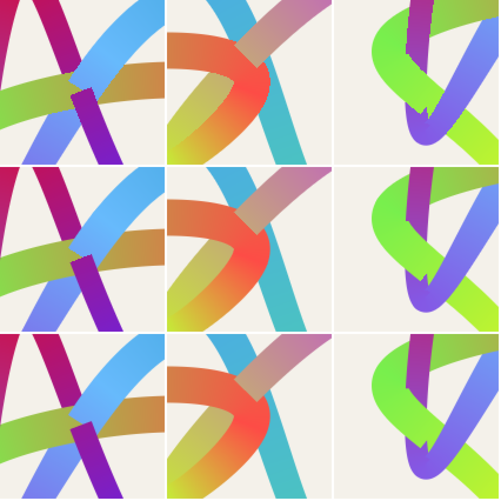

# Issue #86: glosario, `Aporte` y Rejilla

Material de estudio de la [#86](https://github.com/samuelalfaro/primitiva_gota/issues/86). Todo lo de esta carpeta es **propuesta y medida**, nada cambia la API.

- [`GLOSARIO.md`](GLOSARIO.md): glosario de conceptos y homónimos de Vibe (PR #85, movido aquí desde `implementacion/java/`).
- [`rejilla/`](rejilla/): estudio de la Rejilla como componente real (aportes por píxel, prensado, sobremuestreo N×N).

## Decisiones provisionales (de la discusión en la #86)

1. `Tinta` → `Aporte` y `Geometria.capas(...)` → `aporta(...)`: la unidad previa al prensado, venga de una `Gota`, un `Grafo` o un `Grupo`.
2. La **Rejilla** deja de ser metáfora: guarda los aportes de las geometrías y el **prensado** la convierte en imagen. La consulta por píxel se conserva (la usan los mapas y `Coordenadas.parametros`).
3. **Franjas** de `h` filas para acotar memoria (el recorrido se repite por franja; franjas disjuntas, paralelizables).
4. **Sobremuestreo N×N** para antialiasing y subpíxel. `N×N` y el filtro de prensado pertenecen a la **Rejilla**, no al `Aporte` (llevarlo al `Aporte` ahora es optimización prematura).
5. Lo que **funde** (nodos compartidos, `smin`, color continuo en los nodos) es un `Grafo` conexo y entrega un aporte resuelto; lo que no funde es independiente y se apila en la Rejilla.

## Estudio

Preguntas por medir, en orden:

| # | Pregunta | Estado |
|---|---|---|
| 1 | Profundidad de aportes por píxel en los ejemplos (dimensiona la memoria) | primera medida, abajo |
| 2 | Costura entre dos gotas de borde común con N = 1, 2, 3, 4 (conflation) | medida, abajo |
| 3 | ¿Promediar N² muestras al final equivale a no sobremuestrear? Dónde difieren (bordes, texturas, gamma, orden por altura) | pendiente (el prototipo ya permite medirlo) |
| 4 | Qué N iguala la calidad actual con cobertura binaria por muestra (con `common.Compara`) | pendiente |
| 5 | ¿Prensado parcial (seguir añadiendo tras prensar) o solo al final? | abierta |
| 6 | Prototipo de Rejilla real: qué problemas y decisiones aparecen | primer prototipo y trenza, abajo |

### 1. Profundidad de aportes

Método: una clase `Plotter` «sombra» (`rejilla/sombra/pintado/Plotter.java`, copia de la de la biblioteca con un contador) se pone antes en el classpath y cuenta, por píxel y por imagen, las capas con cobertura > 0 que reciben todas las llamadas de `plot`. Los ejemplos no se modifican: `rejilla/medir_profundidad.sh Ejemplo...`.

Medida del 2026-11-28 sobre `main` (ee98871); porcentaje de píxeles tocados por número de capas:

| Ejemplo | píxeles tocados | 1 | 2 | 3 | 4 | 5 | ≥ 6 |
|---|---:|---:|---:|---:|---:|---:|---:|
| Abecedario | 162 877 | 99,93 % | 0,07 % | – | – | – | – |
| PezAbisal | 54 958 | 94,81 % | 4,57 % | 0,49 % | 0,13 % | – | – |
| Escarabajo_by_Gemini | 22 771 | 92,08 % | 7,92 % | – | – | – | – |
| Pulpo_by_Grok | 67 288 | 85,84 % | 6,77 % | 3,56 % | 1,56 % | 1,04 % | 1,22 % |
| Betta | 426 400 | 73,82 % | 13,97 % | 9,83 % | 1,62 % | 0,39 % | 0,38 % |
| Monarca_by_Claude | 574 000 | 58,04 % | 6,44 % | 5,92 % | 6,54 % | 6,55 % | 16,50 % |

Lectura provisional:
- Las láminas de contornos finos (abecedario, pez, escarabajo) están casi siempre en 1 capa: una Rejilla dispersa o por franjas sobra.
- **Cautela:** la cuenta incluye los fondos que se pintan con una `Gota` grande (Betta, Monarca, Escarabajo…), que suman una capa a casi todos los píxeles; la profundidad real de las geometrías es una menos en esos casos. Habría que separar el fondo para afinar.
- Monarca (alas y manchas superpuestas) es el caso exigente: un 16 % de píxeles con 6 o más capas. Es el ejemplo a mirar para dimensionar la memoria por píxel.
- La cuenta es de **capas emitidas**, no de aportes ordenados con cobertura parcial; para el borde (pregunta 2) hará falta otra medida.

### 2. Costura entre dos geometrías de borde común

Método (`rejilla/Costura086.java`): dos cápsulas (gotas de radios iguales con los centros separados: borde recto) se apilan con el borde común en `y = 50 + f`, con `f` fraccionario; la fila de píxeles que cruza el borde recibe la cobertura `f` de la roja y `1 − f` de la azul. El sobremuestreo se simula pintando la escena a escala N con el plotter actual y promediando cajas N×N (no es todavía una Rejilla). El error es la mayor diferencia de canal (0..255) entre la fila del borde y el color ideal `f·rojo + (1 − f)·azul`; el contraste entre los dos colores es de 176 niveles.

Cobertura **analítica** (la actual, parcial por píxel), composición «over»:

| N \ f | 0,10 | 0,25 | 0,50 | 0,75 | 0,90 |
|---:|---:|---:|---:|---:|---:|
| 1 | 18,6 | 39,0 | 52,0 | 39,0 | 19,4 |
| 2 | 17,2 | 26,0 | 0,0 | 26,0 | 16,8 |
| 3 | 14,6 | 13,0 | 17,0 | 13,0 | 14,8 |
| 4 | 12,6 | 0,0 | 0,0 | 0,0 | 12,8 |

Cobertura **binaria** por muestra (umbral 0,5 en la clase sombra, `-Dgota.binaria=true`), que emula muestras puntuales:

| N \ f | 0,10 | 0,25 | 0,50 | 0,75 | 0,90 |
|---:|---:|---:|---:|---:|---:|
| 1 | 17,6 | 44,0 | 191,0 | 44,0 | 17,6 |
| 2 | 17,6 | 96,0 | 0,0 | 96,0 | 17,6 |
| 3 | 17,6 | 15,0 | 44,0 | 15,0 | 17,6 |
| 4 | 17,6 | 0,0 | 0,0 | 0,0 | 17,6 |

Lectura provisional:
- **Con N = 1 la costura existe**: el fondo se cuela hasta 52 niveles (en el peor caso `f = 0,5` el fondo aporta `f·(1 − f)` = 25 %).
- **Con cobertura analítica, sobremuestrear la reduce en proporción a 1/N**, no la elimina: cada muestra sigue teniendo cobertura parcial y el mismo efecto se repite a escala menor. Es exacta solo cuando `N·f` es entero (N = 4, f = 0,25).
- **Con cobertura binaria no hay colado de fondo**: queda solo el error de cuantización, como mucho `|A − B| / (2N)` (≈ 22 con N = 4). Los casos grandes (191 con N = 1 y f = 0,5, 96 con N = 2) son empates: el borde cae justo en el centro de la muestra y el umbral la da por cubierta a las dos formas, de modo que gana la última. Una regla de desempate (fraccionaria, o regla de llenado) en la Rejilla evitaría ese salto.
- Para elegir entre las dos hay que pesar: la analítica no tiene empates ni saltos de cuantización pero conserva la costura residual; la binaria la elimina pero necesita N ≥ 3–4 y una regla de empate.
- Limitaciones: es una escena sintética de bordes rectos y color sólido, con promedio en sRGB (no en luz lineal). Falta repetirlo con bordes curvos, degradados y las capas ordenadas por altura al prensar.

### 3. Prototipo de Rejilla real (`rejilla/prototipo/`)

`Rejilla` (≈ 170 líneas, solo contra `Geometria`/`Tinta`/`Opciones`, sin tocar la biblioteca): las geometrías se **aportan** (`aporta(g, op)`) y `prensa(imagen)` reparte la imagen en franjas de `h` filas; por cada píxel muestrea una cuadrícula N×N, pide a todas las geometrías sus `Tinta`s en cada muestra (el contrato `capas` actual), las **materializa** por fila de muestras (arrays planos), las ordena por altura (estable), las compone src-over, promedia las N×N muestras en premultiplicado (filtro sRGB o lineal) y compone el píxel sobre la imagen. Tres tratamientos de cobertura: `TAL_CUAL`, `ESTRECHADA` (reescala la cobertura a la huella de la muestra) y `BINARIA`. `PruebaRejilla` (`ejecutar.sh`) repite la costura y pinta `Sol_by_Claude` con la Rejilla.

**Validación.**
- Con N = 1 y la cobertura tal cual, la Rejilla coincide con el `Plotter` actual en `Sol_by_Claude`: 14 píxeles de 640 000 difieren en 1 nivel (redondeos).
- Con `ESTRECHADA` la tabla de la costura reproduce exactamente la de la pregunta 2 (que se había simulado pintando a escala N). `BINARIA` también, salvo un empate (N = 3, f = 0,5: 64 frente a 44).

**Problemas y decisiones que han aparecido.**

1. **La cobertura asume píxel = 1.** Con `TAL_CUAL`, sobremuestrear no arregla la costura: el error se queda en ≈ 36 con N = 2, 3 y 4 (con N = 1 era 52), porque cada muestra recibe la cobertura calculada para un píxel entero, es decir, un borde ya suavizado a la anchura de un píxel que luego se vuelve a promediar. Es el mismo motivo por el que la #68 anota que `Opciones` debe llevar la escala del píxel antes de las transformadas. **Decisión:** o el aporte conoce la huella de la muestra (`Opciones` con la escala del píxel; geometrías calculan cobertura para esa huella), o la Rejilla la fuerza a 0/1 (`BINARIA`), o la reescala (`ESTRECHADA`, que solo vale cuando la cobertura sale de una distancia con signo y no de un alfa de color).
2. **El empate en el borde exacto.** `BINARIA` cubre en el valor 0,5; si el borde cae justo en el centro de la muestra, las dos formas la cubren y gana la última. Hace falta una regla de desempate (p. ej. reparto de la muestra entre las dos por cobertura, o regla de llenado).
3. **Coste N² en tiempo, no en memoria.** `Sol_by_Claude` (800×800): Plotter 6,1 s; Rejilla N = 1 6,6 s; **N = 3, 47 s** (7,7× más). El coste es evaluar `capas` en 9 veces más puntos y `Grafo.capas` es lo caro. Aplicar N solo donde el píxel tiene cobertura parcial no es una optimización opcional: sin ella N ≥ 3 no es utilizable por defecto.
4. **La memoria no obliga a las franjas.** La profundidad máxima en `Sol` es 4 y una franja de 32 filas materializa ≈ 50 000 aportes con N = 1 y ≈ 450 000 con N = 3 (≈ 1 y 11 MB a 24 B por aporte). Las franjas solo harían falta para materializar y **conservar** los aportes (re-prensar sin recalcular); si se prensa en el acto, basta una fila de muestras por hilo.
5. **El orden entre geometrías cambia de semántica.** Hoy dos llamadas a `plot` se componen en orden de llamada aunque las `Tinta` tengan alturas distintas; la Rejilla ordena **todas** por altura (estable). Con alturas 0 es idéntico (por eso `Sol` coincide), pero es un cambio de contrato que hay que decidir y documentar.
6. **`Grupo` ya es una Rejilla pequeña.** `Grupo.capas` reúne las capas de sus hijos y las ordena por altura estable en cada punto; la Rejilla sería el muestreo y el almacén encima de eso. Mucho del contrato ya existe.
7. **Las geometrías no son seguras para hilos al empezar.** `Grafo.bounds()` construye en perezoso y sin sincronizar: llamarlo desde el muestreo en paralelo lanzó `NullPointerException`. La Rejilla debe pedir `bounds()` de todas las geometrías en serie antes de muestrear, como ya hace el `Plotter`; en la API conviene una fase de preparación explícita.
8. **El filtro (sRGB frente a lineal) es una decisión de la Rejilla**: está implementado (`Filtro`) pero no se ha medido todavía; el efecto esperado es que promediar en sRGB oscurezca los bordes de formas claras sobre fondo oscuro, y queda por comprobar.

**Siguiente.** Pregunta 3 (equivalencia del promedio al final) con degradados, texturas y gamma; y medir `ESTRECHADA` frente a `BINARIA` en bordes curvos con un N razonable (2 o 3), más la versión adaptativa (N solo en bordes) para ver cuánto del coste N² se recupera.

### 4. La trenza aleatoria con la Rejilla (`rejilla/prototipo/PruebaTrenza.java`)

La «prueba de fuego» de `TrenzaAleatoria` (semilla 7: un lazo cerrado de 16 nodos, 11 cruces consigo mismo, altura por arista que alterna encima/debajo en cada cruce). Se pinta de dos maneras: **A**, el `Grafo` con el `Plotter` actual (una sola capa por píxel: la gota que manda, con la cobertura de la unión); y **B…E**, cada arista como su propia cinta (`Pintada` de su gota) que aporta a la Rejilla color, cobertura propia y la altura del cruce (la misma función que da la altura a las aristas del Grafo), y es la Rejilla quien ordena en cada muestra.

| Variante | tiempo | dif. con A |
|---|---:|---:|
| A: Grafo + Plotter | 3,3 s | – |
| B: Rejilla N = 1 | 2,3 s | 4 620 px |
| C: Rejilla N = 3 (cobertura estrechada) | 10,2 s | 9 684 px |
| D: B + prioridad de cuerpo | 1,6 s | 906 px |
| E: C + prioridad de cuerpo | 14,1 s | 5 997 px |

Filas A (Grafo), D (Rejilla N = 1 con prioridad de cuerpo) y E (N = 3); columnas: un cruce, un nodo y un giro cerrado (ampliado ×2).

**Qué muestra.**

1. **El borde de la cinta que pasa por encima queda con antialiasing en la Rejilla y con escalones en el Grafo.** En el Grafo el píxel lleva la cobertura de la *unión* (1 donde hay otra cinta debajo), así que el contorno de la cinta de arriba sobre la de abajo es duro; en la Rejilla cada cinta aporta su propia cobertura y se compone sobre la de debajo. Se ve en el cruce de la primera columna y en el giro cerrado de la tercera. Es la ventaja que se buscaba y es una consecuencia directa del modelo (un aporte por geometría, no uno ya resuelto).
2. **Aparece un defecto nuevo en los nodos (variante B/C): un disco visible.** En un nodo las dos cintas vecinas tienen la misma altura (la altura es continua), y el empate lo resuelve el orden de emisión, de modo que la tapa de una cinta queda sobre el cuerpo de la siguiente. El `Grafo` lo evita con una regla que no es de altura: entre las gotas que contienen el píxel manda **primero la que lo tiene en su cuerpo** (no en la tapa) y después la altura. Codificada en el aporte (variante D/E: `altura + 1000` si el píxel está en el cuerpo) el disco desaparece y el resultado se parece a A, con 906 píxeles de diferencia en N = 1, que son los bordes suavizados.
3. **Conclusión de diseño:** el `Aporte` no puede llevar solo `altura`. Hace falta un segundo eje de ordenación que cubra el caso cuerpo/tapa (una **prioridad** entera o un orden lexicográfico `(prioridad, altura)`), o que la regla viva en la propia geometría al emitir. Con eso, un `Grafo` conexo podría **emitir un aporte por gota** (sin resolver el ganador por dentro) y la Rejilla haría el tejido y el antialiasing correctos en los cruces. El `smin` (suavizado entre gotas) sí seguiría siendo del `Grafo`.
4. **Lo que no resuelve:** los cortes duros en la punta de las cintas (muescas de la #46) siguen igual: no vienen del orden sino de la parametrización TRAZO.
5. **Coste.** N = 1 es más rápido que el `Plotter` (1,6 s frente a 3,3 s) probablemente porque cada cinta solo se evalúa en sus `bounds` y no hay que decidir el ganador por píxel entre 16 gotas (causa sin comprobar; los tiempos son de una sola ejecución); N = 3 vuelve a costar ≈ N² (14 s).

**Limitaciones.** Una sola semilla (la 7); la altura se replica de `TrenzaAleatoria` (no se ha mirado la 42, la de cruces muy juntos); la regla de cuerpo usa los cortes de la tira por defecto (con `Reparto.GLOBAL` el `Grafo` usa cortes por gota); las diferencias se han valorado a ojo en tres zonas.
